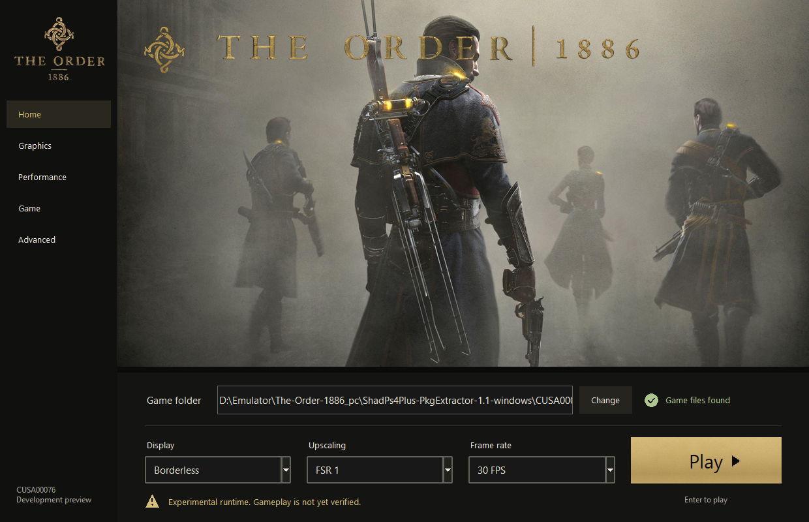

# The Order: 1886 para PC — runtime experimental de compatibilidad con PS4

[English](README.md) · [Português (Brasil)](README.pt-BR.md) · **Español**

Proyecto comunitario para ejecutar el binario original de **The Order: 1886**, edición PS4 **CUSA00076**, mediante un launcher nativo de Windows y un runtime Vulkan. Reutiliza infraestructura de carga PS4 y trabajo de gráficos/APIs de [shadPS4](https://github.com/shadps4-emu/shadPS4).

**En desarrollo.** El juego inicia y renderiza cinemáticas 3D, como muestra la grabación del 17 de octubre. También se han observado la inicialización del guardado y su reapertura. Siguen pendientes la jugabilidad interactiva, la progresión por puntos de control, 30 minutos de estabilidad y la salida 4K a 60 FPS. El registro enviado termina en una aserción Vulkan: la imagen solicita 8.029 capas frente a un límite de 2.048. No es un lanzamiento oficial para PC ni un port confirmado como jugable.

*Captura real del launcher de cinco páginas con la imagen proporcionada por el usuario el 17 de octubre. No es gameplay. “30 FPS” es el límite seleccionado, no una medición.*

## Demostración en vídeo

[**Mira la demostración en YouTube**](https://youtu.be/wpNkwih0cxI) — grabación del proyecto ejecutándose en PC, publicada por **Julio Cacko**. Haz clic en la miniatura para verla.

## El launcher

Estructura adaptada de [mateussmeneses/theorder1886-port](https://github.com/mateussmeneses/theorder1886-port), conservando nuestro backend y los guardados de CUSA00076. La presentación del README sigue la organización de [HayatoG/iss_pc](https://github.com/HayatoG/iss_pc).

| Página | Función |
| --- | --- |
| Home | Carpeta del juego, opciones rápidas y Play/Stop |
| Graphics | Pantalla, relación de aspecto, FSR 1/Linear y VSync |
| Performance | 30 FPS, 60 FPS experimental y overlay F9 |
| Game | Verificación, carpeta de datos, copias de seguridad y restauración de guardados |
| Advanced | Runtime opcional, registros, carpetas, versiones y soporte |

Usa **Save settings** para guardar las opciones. Iniciar desde una página de opciones también guarda los valores antes de abrir el juego. Restaurar requiere confirmación y crea una copia del guardado reemplazado; se bloquea durante una sesión. El launcher anterior sigue disponible con `python launcher/order1886_launcher.py --classic`. Las opciones GPU, mods y actualizador de referencia necesitan adaptación; consulta el [análisis de reutilización](docs/order1886-reference-reuse.md).

## Iniciar

Usa tu propia copia extraída de CUSA00076 con `eboot.bin`, `sce_sys` y `sce_module`. No se distribuyen ejecutables, dumps ni partidas guardadas del jugador. Los originales se conservan; las imágenes preparadas, configuración, cachés, registros, guardados y copias de seguridad se almacenan aparte.

1. Extrae el paquete portátil completo en una carpeta con permisos de escritura.
2. Abre **The Order 1886.exe** y selecciona **Game folder** en la barra inferior.
3. Empieza con **30 FPS** y elige el modo de pantalla y FSR 1 o Linear.
4. Usa **Play**, **Advanced → View session log** y **Stop session** para iniciar, revisar o detener la sesión.

Desde el código fuente, ejecuta `Launch The Order 1886.cmd` o `python launcher/order1886_launcher.py` después de seguir las [instrucciones de compilación para Windows](docs/order1886-build.md). El paquete no requiere Python ni MSYS2. No existe un paquete Linux verificado para este objetivo específico.

## Estado y rendimiento

El launcher ofrece Ventana/Sin bordes/Pantalla completa, VSync y overlay de rendimiento (F9). **60 FPS es opcional y experimental**: falta verificar contenido sensible al tiempo, incluidos los capítulos 6 y 9. El objetivo es salida 3840 × 2160 con reescalado permitido y 60 FPS sostenidos durante gameplay; aún no se ha alcanzado.

Consulta el [informe completo del estado actual, en inglés](docs/STATUS.md), la [evidencia del runtime](docs/order1886-runtime-status.md) y el [plan 4K/60](docs/order1886-4k60-verification.md). Un bloqueo anterior del PC requirió reinicio manual; la causa sigue siendo desconocida. Las pruebas de CPU y del launcher no demuestran estabilidad ni jugabilidad.

## Problemas y licencia

Abre **Advanced → Open log folder**. Al [informar de un problema](https://github.com/JulioCacko/The-Order-1886_pc/issues), incluye los registros y `last-run.json` correspondientes de `user/order1886/logs`, SHA256 del runtime, metadatos del juego y GPU/controlador. Elimina datos privados; no adjuntes archivos del juego ni partidas guardadas.

[GPL-2.0-or-later](LICENSE). Infraestructura reutilizada de [FelipePrado0/gow3_pc](https://github.com/FelipePrado0/gow3_pc) y [shadPS4](https://github.com/shadps4-emu/shadPS4), conservando atribución y licencias. The Order utiliza otro motor; los parches y el rendimiento de otro título no demuestran compatibilidad. Sin afiliación ni respaldo de Ready at Dawn o Sony.
