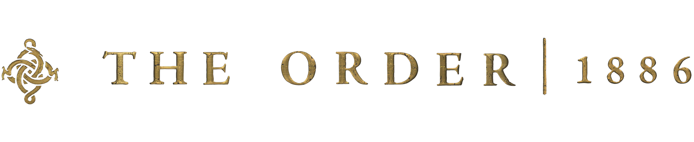
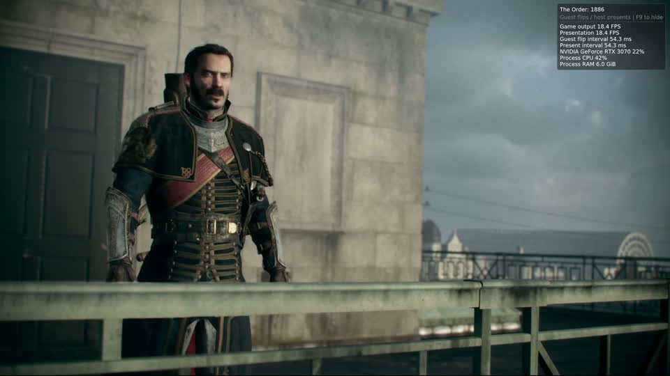
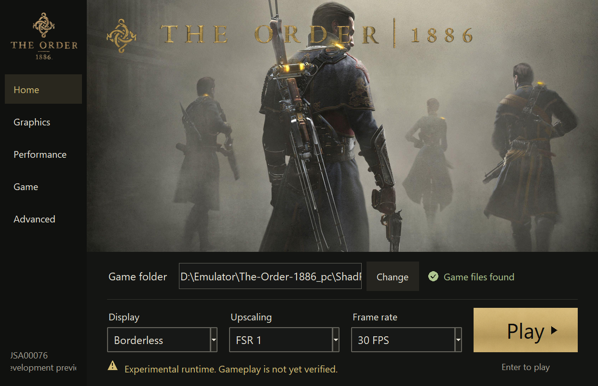
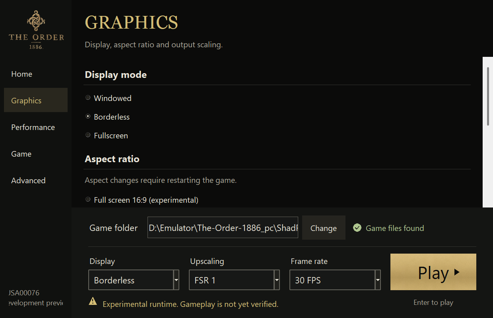
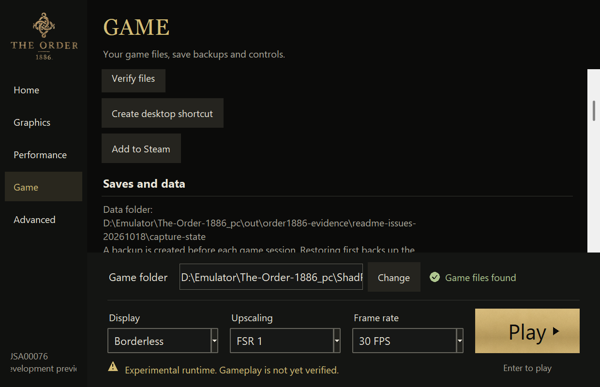
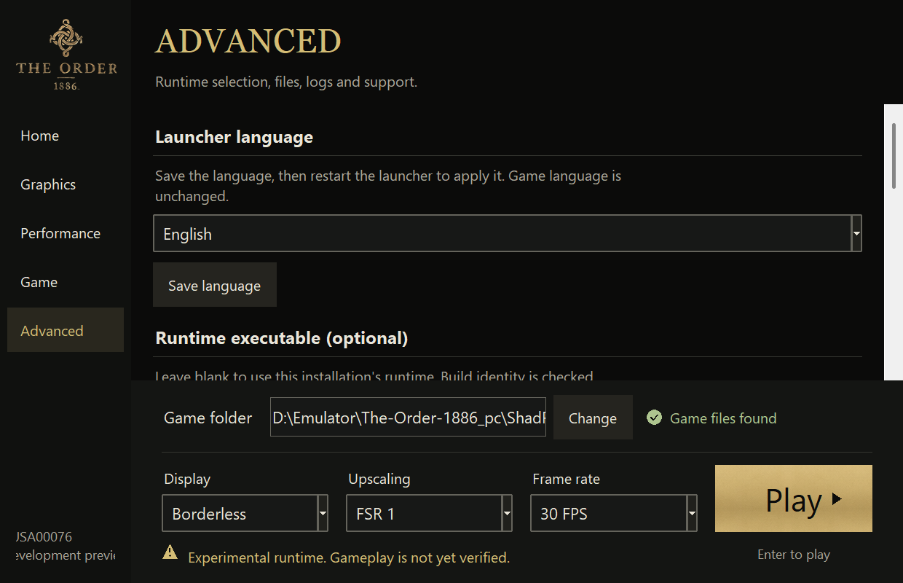

<p align="center"></p>
<h1 align="center">The Order: 1886 — PC</h1>

<p align="center">Native x86-64 execution · PS4 compatibility runtime · Vulkan graphics</p>

<p align="center">
  <a href="README.pt-BR.md"><b>Português (Brasil)</b></a> ·
  <a href="README.es.md">Español</a> ·
  <a href="https://github.com/JulioCacko/The-Order-1886_pc/releases/download/v0.1.0-go-preview.8/order1886-go-windows.zip"><b>Download Windows ZIP</b></a> ·
  <a href="https://github.com/JulioCacko/The-Order-1886_pc/releases">Releases</a> ·
  <a href="https://github.com/JulioCacko/The-Order-1886_pc/issues">Report a problem</a>
</p>

<p align="center">
  <a href="https://github.com/JulioCacko/The-Order-1886_pc/actions/workflows/order1886-go-preview.yml"></a>
  <a href="LICENSE"></a>
</p>

> **Development preview.** Cinematics render and a street route has been exercised, but performance remains slow and full gameplay, checkpoint progression and sustained 4K/60 are not accepted. The latest automated checks pass; see [Status](#status).

**The Order: 1886** for PlayStation 4, running on a PC through a dedicated
compatibility runtime. The original x86-64 executable runs on the host CPU,
PS4 system interfaces are reimplemented, and a
[shadPS4-derived video core](https://github.com/shadps4-emu/shadPS4) translates
GPU commands and shaders to Vulkan. The current target is **CUSA00076 on Windows**, with an experimental Linux x86-64 package.

> **No game files are included.** You need your own extracted copy. This is an
> unofficial community project, not an official PC release.

## Video demonstration

[](https://youtu.be/wpNkwih0cxI)

[**Watch the demonstration on YouTube**](https://youtu.be/wpNkwih0cxI) — video evidence of the project running on PC, published by **Julio Cacko**. Click the thumbnail to watch.



<sub>Actual capture at 15:00 in the supplied October 17 recording, reduced from 1920×1080. This is a cinematic, not proof of interactive gameplay or a performance benchmark.</sub>

## What's new

**Preview 8 — 20 October 2026.** The Windows and Linux x86-64 packages are built from revision `e877470`, the Go launcher is the only launcher, and every rendering option states why it is unavailable while the runtime cannot honour it. [Release notes](https://github.com/JulioCacko/The-Order-1886_pc/releases/tag/v0.1.0-go-preview.8) · [What this build does and does not establish](docs/verification/2026-10-20-runtime-hardening.md).

**Preview 8 — 20 October 2026.** These are the changes accumulated since preview 4.

- **Input and direct play:** configurable mouse-to-stick camera input, sensitivity and inverted Y; **Play The Order 1886.exe** uses saved settings and the shared session/log lifecycle. Game includes desktop-shortcut and Add to Steam actions.
- **Saves and asset mods:** original-preserving `_data` overlays with explicit enable/order/conflict controls; save backup/restore now keeps the newest backup even when many are created in the same second. External executable patches remain unsupported.
- **Launcher utilities:** 13 selectable UI languages with English fallback and safe shader-cache clearing. The selection also requests the same PS4 game language at next launch; matching assets are required. Arabic/CJK visual acceptance and independent text/voice selection remain open.
- **Shader and runtime fixes:** unordered NaN comparisons, legacy reciprocal square root, exclusive float atomic fallbacks, byte-preserving pipeline keys, mapped-range probe caching and busy-mutex lifetime protection. Preparation also accepts validated unpacked x86-64 ELF dumps.
- **Verification:** **340 Windows Python tests, zero skips; Linux suite: 340 run, 21 skips; Windows 41 native checks and Linux native subset pass; Windows 15 and Linux 10 relocated package checks.** [Release verification](docs/verification/2026-10-18-preview4-release.md).

See [implementation and issue status](docs/order1886-issue-status.md). These checks do not certify gameplay or frame rate.

## Status

| Area | Current evidence | Remaining acceptance |
| --- | --- | --- |
| Boot and rendering | Supplied cinematic recording; Chapter 2 run with copied saves | Representative interactive route, checkpoint save/load and progression |
| Windows launcher/package | Five pages, saved settings, direct play, desktop/Steam shortcuts, backup and cache tools; 15 portable checks pass | Broader DPI/language coverage and end-to-end player validation |
| Input and mods | Mouse-to-stick path and reversible asset-overlay fixtures pass | Remapping UI, direct camera hook, gameplay/QTE and real mod validation |
| Graphics stability | Descriptor guards retained; copied-save run reached its 900.959-second timeout without the 8,029-layer/assertion marker | Residual SRT errors, exact original crash sequence and full stability run; [#5](https://github.com/JulioCacko/The-Order-1886_pc/issues/5) remains open |
| Performance | User reported slow street performance; mapped-range and shader/cache fixes pass local regressions | Same-viewpoint frame-time comparison and sustained 4K/60 |
| Temporal providers | FSR 1 and Linear presentation available | Gameplay-qualified DLSS, FSR 3.1/4, XeSS and temporal inputs |
| Game versions | Current local preparation checks use CUSA00076 | Update 1.02/fullscreen/high-FPS report [#23](https://github.com/JulioCacko/The-Order-1886_pc/issues/23) remains unverified |

The Chapter 2 duration includes menus/loading and ended by forced timeout; it is not 15 minutes of measured street gameplay. No FPS improvement is claimed.

See [current status](docs/STATUS.md), [issue tracking](docs/order1886-issue-status.md), [integration evidence](docs/verification/2026-10-18-gold-work.md), and the [4K/60 acceptance plan](docs/order1886-4k60-verification.md).

## Download and start

**Published download: preview 8 (October 20).** Windows and Linux x86-64 packages are available, both built from revision `e877470`. Preserve your `user` folder when upgrading.

**[Download the Windows package](https://github.com/JulioCacko/The-Order-1886_pc/releases/download/v0.1.0-go-preview.8/order1886-go-windows.zip)** ·
**[Download the Linux package](https://github.com/JulioCacko/The-Order-1886_pc/releases/download/v0.1.0-go-preview.8/order1886-linux-x86_64.tar.gz)** ·
[Release notes](https://github.com/JulioCacko/The-Order-1886_pc/releases/tag/v0.1.0-go-preview.8) ·
[Setup guide](https://github.com/JulioCacko/The-Order-1886_pc/releases/download/v0.1.0-go-preview.8/QUICKSTART.txt) ·
[Windows checksum](https://github.com/JulioCacko/The-Order-1886_pc/releases/download/v0.1.0-go-preview.8/order1886-go-windows.zip.sha256) ·
[Linux checksum](https://github.com/JulioCacko/The-Order-1886_pc/releases/download/v0.1.0-go-preview.8/order1886-linux-x86_64.tar.gz.sha256)

The preview includes the launcher, dedicated runtime, required libraries and
**`QUICKSTART.txt`**. No Python, MSYS2 or compiler is required. Download
`order1886-go-windows.zip`; GitHub's “Source code” archives are for developers.
The release also provides a ZIP checksum. Game files are supplied separately
by you; this preview retains the [known compatibility limitations](#status).

**Linux x86-64 is built again**, as a portable `tar.gz` from the Go launcher, the native runtime and the Python worker. It is **not qualified**: nothing in it has run The Order: 1886, and the smoke that guards it covers the package, not the game. Requirements are a Vulkan-capable driver and a desktop session with GTK 3 and WebKitGTK 4.1. The runtime needs clang rather than GCC 13, because the shader compiler uses C++23 explicit object parameters. See the [Windows build guide](docs/order1886-build.md), which also documents the Linux path.

For a portable Windows package:

1. Extract the entire ZIP to a writable folder. Keep the executable, `bin` and `_internal` together.
2. Read **QUICKSTART.txt**, then open **The Order 1886.exe**.
3. Choose your extracted **CUSA00076** folder. It must contain `eboot.bin`, `sce_sys`, `sce_module`, `_data` and `archivemap.bin`.
4. Start with **30 FPS**, choose a display mode and press **Play**.
5. Use **Advanced → View session log** for progress, or **Stop session** to end the session.

Packaged users do not need Python or MSYS2. Original game files stay unchanged;
prepared images, settings, caches, logs, saves and backups live under the
installation's `user/order1886` folder.

For a source checkout, open `Launch The Order 1886.cmd` or run the Go launcher you built:

```powershell
./launcher-go/build/bin/The Order 1886.exe
```

## The launcher

The launcher is a Go/Wails application (`launcher-go`). The screenshots below show the **retired Tk window** and are kept as a record of the previous interface; the table describes the settings the Go launcher carries.



<sub>Retired launcher captured on October 18 at 1240 × 800 with isolated settings. It is UI only; the selected 30 FPS is configuration, not a benchmark.</sub>

| Page | Available controls |
| --- | --- |
| **Home** | Game folder, display, presentation filter, frame rate and Play/Stop |
| **Graphics** | Window mode, original/experimental 16:9 aspect, FSR 1/Linear and VSync |
| **Performance** | Native 30 FPS, experimental 60 FPS and F9 overlay |
| **Game** | Verify files, direct-play desktop shortcut, Add to Steam, save backups, ordered asset mods and mouse controls |
| **Advanced** | Launcher language, optional runtime, logs/folders, shader-cache clearing and manual release links |

<details><summary>Retired launcher screenshots</summary>







</details>

Use **Save settings** after editing; launching from a settings page saves its values. Navigation keeps unsaved edits, and **Escape** returns Home. The launch bar stays available on every page.

**Saves:** on Game, select a backup and press Play to confirm restoration before launch, or use Restore selected backup. Current saves are backed up first; then choose Continue/Load in the game. Older snapshots may lack Profile or progress. Saves use the SFO’s `INSTALL_DIR_SAVEDATA=CUSA00035`; do not rename that folder to CUSA00076.

**Language:** save the choice on Advanced and restart the launcher. The next game launch requests that PS4 system language, including Brazilian Portuguese. Matching game language assets must be installed; independent text/voice controls remain open.

For mouse look, open **Game → Controls**: sensitivity and inverted Y persist. In the game window **Esc** releases the cursor and **F6** toggles capture; focus loss releases it automatically. This supplies the PS4 right stick; a direct 1:1 camera hook and remapping UI remain open. See the [input/direct-play guide](docs/order1886-input.md).

**Play The Order 1886.exe** starts with the same saved configuration, preparation and logs as Play. Keep it beside `_internal` and `bin`. Use **Game → Add to Steam** with Steam closed; the action preserves existing shortcuts and is idempotent. Reopen Steam afterwards.

[Asset mod formats and limits](docs/order1886-mods.md) describe reversible `_data` overlays. Updates are installed manually; automatic updating, external executable patches, a Cheats page, independent game text/voice and a live Achievements page are not complete. The Tk window that used to be the fallback launcher has been removed; the Go launcher is the only one.

## Graphics and performance

**FSR 1** is spatial presentation scaling; temporal FSR and DLSS are not exposed
by this build. The 4K/60 target is **3840×2160 output with upscaling acceptable**,
preserved detail and sustained 60 FPS in gameplay. It has not passed.

**60 FPS is experimental.** The timing recipe warns of possible QTE softlocks
in Chapters 6 and 9. A host presentation rate or selected cap does not establish
that the game produces that many new frames. Use the 30 FPS baseline first.

## Known problems and reporting

| Problem | What to do |
| --- | --- |
| `Image exceeds device format limits`, `layers=8029/2048` | Preserve the boot log and matching `last-run.json`. Descriptor validation and targeted inactive-resource guards remain enabled. Keep the matching descriptor/shader evidence; the original crash is not closed by a timeout run. |
| Low or varying frame rate | Include the scene, settings, GPU/driver and matching log. Shader compilation and compatibility work remain in progress. |
| Runtime missing or identity rejected | Keep the complete package together, or build a matching runtime. Use Advanced for an explicit runtime override. |
| Experimental 60 FPS timing problems | Return to 30 FPS and report the chapter and reproduction steps. |

Open **Advanced → Open log folder**. When
[reporting a problem](https://github.com/JulioCacko/The-Order-1886_pc/issues), include
`last-run.json`, the matching boot/session log, runtime SHA256, game metadata,
GPU/driver and reproduction steps. Review logs for personal paths before sharing;
do not upload game binaries or saves.

A previous instrumented session coincided with a full-PC freeze requiring a
reset; its cause remains unknown. The October 17 image assertion is separate
evidence and does not establish the cause of that freeze.

## Building from source

Follow the [Windows build guide](docs/order1886-build.md) and initialize its
required submodules. From PowerShell:

```powershell
& C:\msys64\usr\bin\bash.exe build.sh --test
out/order1886-pyenv/Scripts/python.exe -m unittest discover -s tests
```

After the native build succeeds, create the portable preview. The Go launcher is
the only launcher, and this builder packages it together with the payload from
source:

```powershell
./packaging/windows/order1886-go-build.ps1 -Runtime ./out/order1886-runtime.exe
```

The builder bundles the Go launcher (as both entry points), the dedicated
runtime with every DLL it imports, the worker the launcher drives, build identity
and license notices. The
[portable smoke verifier](packaging/windows/order1886-go-smoke.py) checks a
relocated package without starting gameplay. Build, CPU and smoke checks are
separate from graphics and gameplay acceptance.

## How it works

| Layer | Role |
| --- | --- |
| Loader | Prepares a hash-checked copy of the original executable and links its modules |
| Runtime | Reimplements the PS4 system interfaces used by this title |
| Video | Translates PS4 GPU commands and shaders to Vulkan/SPIR-V |
| Launcher | Configures the dedicated backend and manages sessions, logs and save backups |

## Credits and license

[GPL-2.0-or-later](LICENSE). Loader/build infrastructure derives from
[FelipePrado0/gow3_pc](https://github.com/FelipePrado0/gow3_pc); graphics/API work
derives from [shadPS4](https://github.com/shadps4-emu/shadPS4).
The five-page launcher structure is adapted from
[mateussmeneses/theorder1886-port](https://github.com/mateussmeneses/theorder1886-port).
README organization is inspired by [HayatoG/iss_pc](https://github.com/HayatoG/iss_pc).
Exact revisions and reuse decisions are recorded in the
[assessment](docs/order1886-reference-reuse.md); portable builds retain the
[attribution notice](packaging/windows/ATTRIBUTION-Order1886.txt).

The Order: 1886 belongs to its respective rights holders, including Sony
Computer Entertainment and Ready at Dawn. This project is not affiliated with
or endorsed by them. No game executable, dump or player save is distributed.
