<p align="center">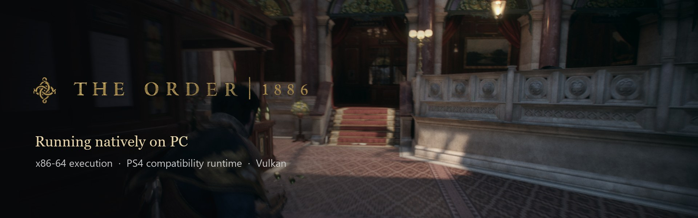</p>

<h1 align="center">The Order: 1886 — PC</h1>

<p align="center">Native x86-64 execution · PS4 compatibility runtime · Vulkan graphics · Windows and Linux</p>

<p align="center">
  <a href="https://github.com/JulioCacko/The-Order-1886_pc/releases"></a>
  <a href="https://github.com/JulioCacko/The-Order-1886_pc/releases"></a>
  
  
  <a href="https://github.com/JulioCacko/The-Order-1886_pc/actions/workflows/order1886-go-preview.yml"></a>
  <a href="LICENSE"></a>
</p>

<p align="center">
  <a href="https://github.com/JulioCacko/The-Order-1886_pc/releases/download/v0.2.0/order1886-go-windows.zip"><b>⬇ Windows package</b></a> ·
  <a href="https://github.com/JulioCacko/The-Order-1886_pc/releases/download/v0.2.0/order1886-linux-x86_64.tar.gz"><b>⬇ Linux package</b></a> ·
  <a href="https://github.com/JulioCacko/The-Order-1886_pc/releases/tag/v0.2.0">Release notes</a> ·
  <a href="README.pt-BR.md">Português (Brasil)</a> ·
  <a href="README.es.md">Español</a> ·
  <a href="https://github.com/JulioCacko/The-Order-1886_pc/issues">Report a problem</a>
</p>

> **Development preview.** Gameplay runs from a player's save at about 53 FPS in the night courtyard on an RTX 3070 (60 FPS mode), and the hotel lobby fight averages 38 FPS with dips. Full progression, long-session stability, the Chapter 6/9 QTE timing and sustained 4K/60 are not accepted yet. See [Status](#status).

**The Order: 1886** for PlayStation 4, running on a PC through a dedicated
compatibility runtime. The original x86-64 executable runs on the host CPU,
PS4 system interfaces are reimplemented, and a
[shadPS4-derived video core](https://github.com/shadps4-emu/shadPS4) translates
GPU commands and shaders to Vulkan. The target is **CUSA00076**, on Windows and Linux x86-64.

> **No game files are included.** You need your own extracted copy. This is an
> unofficial community project, not an official PC release.

## Gameplay on PC

Captured from the preview 9 Windows package on an RTX 3070 at 1920×1080 in 60 FPS mode. Each image is the game window only, cropped to the 1920×800 scene the game renders.

<table>
  <tr>
    <td width="50%">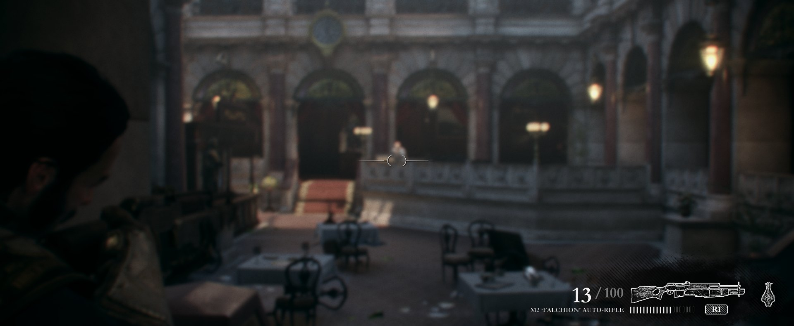</td>
    <td width="50%">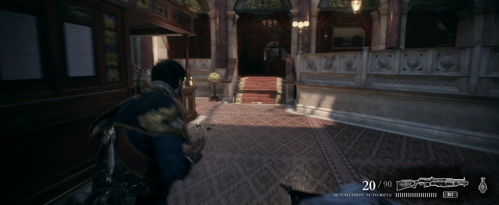</td>
  </tr>
  <tr>
    <td>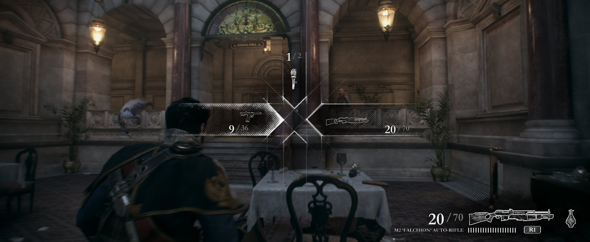</td>
    <td>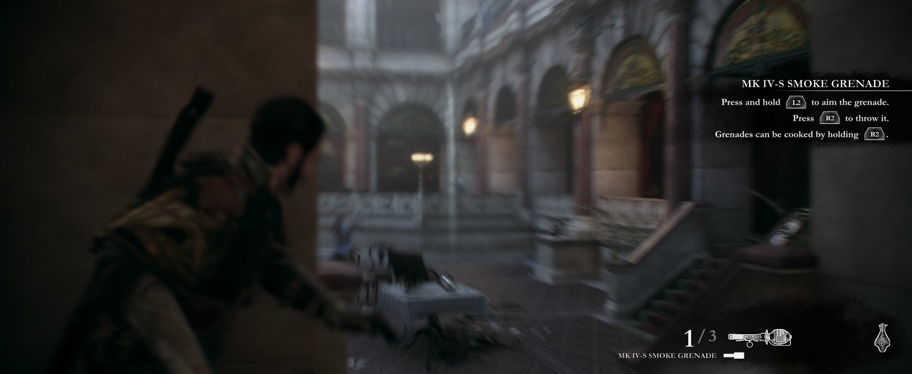</td>
  </tr>
  <tr>
    <td>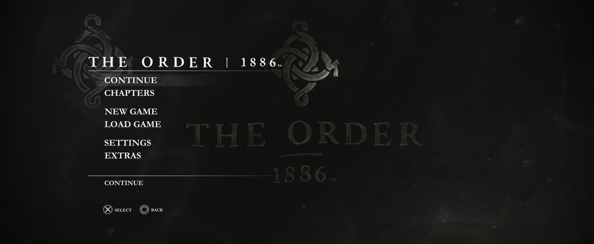</td>
    <td>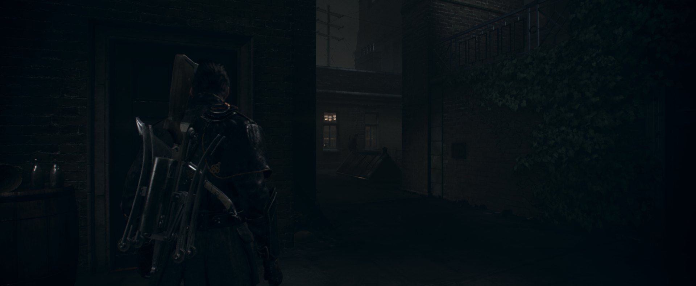</td>
  </tr>
</table>

### Video demonstration

[](https://youtu.be/wpNkwih0cxI)

[**Watch the demonstration on YouTube**](https://youtu.be/wpNkwih0cxI), published by **Julio Cacko**.

## Proof: preview 9 on Windows and Linux

<table>
  <tr>
    <th width="50%">Windows 11 · RTX 3070 · packaged build</th>
    <th width="50%">Ubuntu 26.04 (WSL) · packaged build</th>
  </tr>
  <tr>
    <td>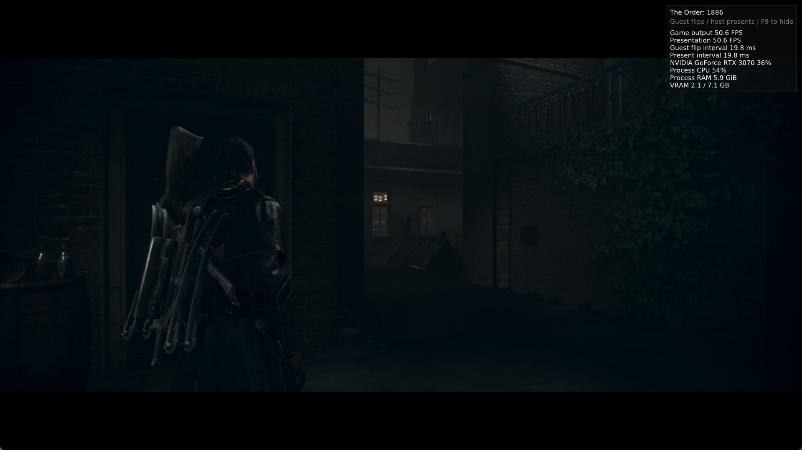</td>
    <td>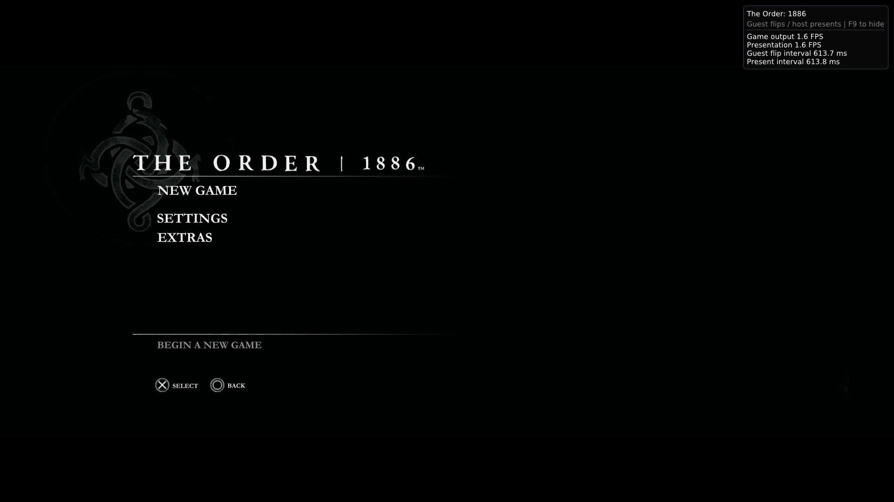</td>
  </tr>
  <tr>
    <td>Gameplay from a copied save. Overlay: 50.6 FPS, GPU 36 %, VRAM 2.1 GB. Over the measured minute: <b>53.2 FPS, p99 23 ms</b>.</td>
    <td>The Linux package's own runtime on a clean Ubuntu 26.04 that has none of the build machine's libraries: intro, start screen and title menu, driven by keyboard input. WSL offers only software Vulkan (lavapipe), so it runs at 1–2 FPS and the menu's 3D background stays dark; playing needs a GPU driver.</td>
  </tr>
  <tr>
    <td>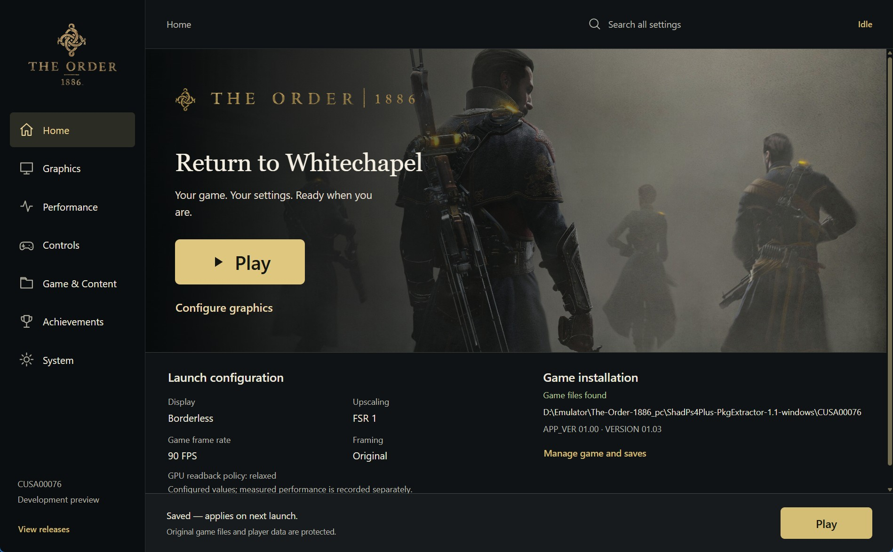</td>
    <td>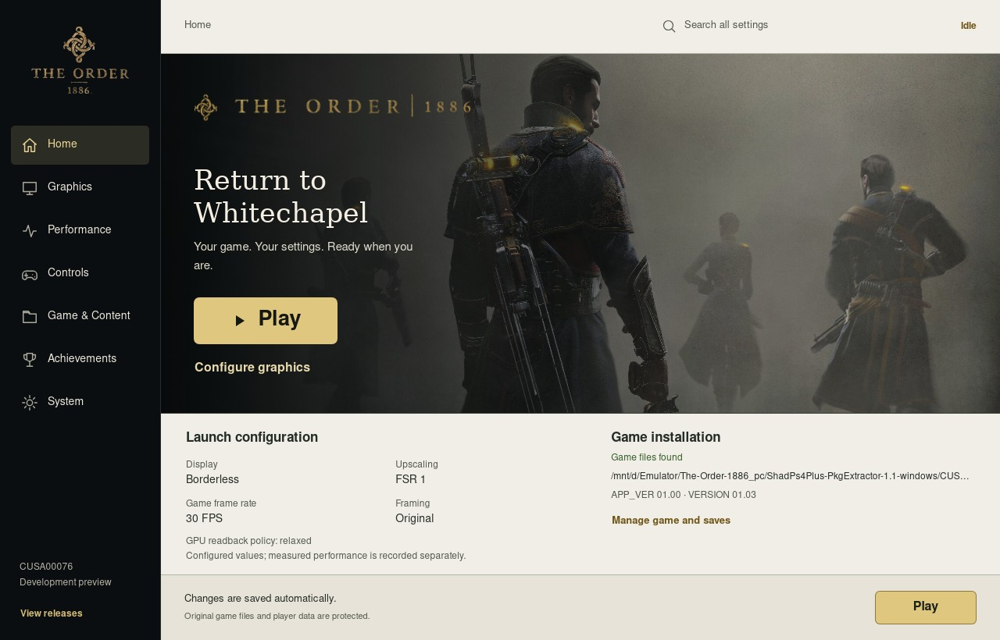</td>
  </tr>
</table>

How these were taken, with hashes and logs: [preview 9 release verification](docs/verification/2026-10-21-preview9-release.md).

## What's new

**v0.2.0 — 24 October 2026.** [Release notes](https://github.com/JulioCacko/The-Order-1886_pc/releases/tag/v0.2.0)

- **Aiming no longer explodes the scene** (#106), **the smoke grenade draws its cloud** (#107), **no black flecks on faces** (#101) and **no mid-fight freeze** on a runaway indirect draw (#103).

<table>
  <tr><td>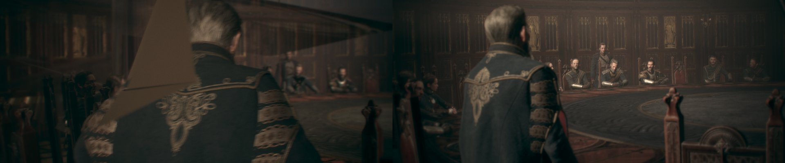</td></tr>
  <tr><td>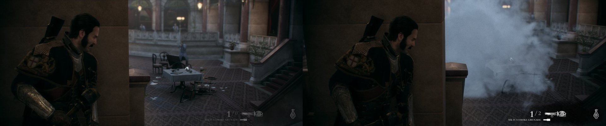</td></tr>
</table>

- **AMD FSR 3.1 and NVIDIA DLAA** replace the game's temporal anti-aliasing (#97, #98). **Shaders compile in the background** by default (#105). **Trophy names** come from your own game with your console key (#99).
- **Go launcher only** (#108): the old Tkinter launcher and the inherited God of War leftovers are gone.
- **Known issue:** short black flashes still appear during gameplay; the cause is being investigated.

**Preview 9 — 21 October 2026.** [Release notes](https://github.com/JulioCacko/The-Order-1886_pc/releases/tag/v0.1.0-go-preview.9)

- **Playable frame rate.** The slow courtyard went from 7.2 to about 53 FPS. Memory-table locking, buffer readbacks and the draw pipeline were ported from [IgorAugustoHH/The-Order-1886-PC-Port](https://github.com/IgorAugustoHH/The-Order-1886-PC-Port) (#93).
- **Graphics options that work.** Output resolution, sharpening, anisotropic filtering, overlay items, frames queued, async shaders and warm-up now reach the runtime (#90). 90 FPS and Unlocked engine timing come with a 30–240 presentation cap (#91). Film grain, motion blur, depth of field and chromatic aberration really switch off (#92).
- **Temporal upscaling groundwork.** The game's temporal resolve is mapped and its velocity validated in the runtime, and an FSR 3.1 provider can replace it at native resolution (#94). The launcher does not offer it yet.
- **A Linux package that starts.** It now carries its FFmpeg, SDL3, fmt and Zydis libraries instead of expecting the build machine's; before, the runtime failed on any other system.
- **Fixes.** Gameplay no longer renders flat blue after a depth clear (#88). A startup heap corruption with async shaders is gone. Launcher text is readable under a light desktop theme. The in-launcher updater accepts this release's receipt.

See [implementation and issue status](docs/order1886-issue-status.md).

## Status

| Area | Current evidence | Remaining acceptance |
| --- | --- | --- |
| Boot and rendering | Title, menus, cinematics and gameplay in the courtyard and the hotel from copied saves | Full progression, checkpoint save/load across chapters |
| Performance | About 53 FPS in the courtyard and 38 FPS in the hotel fight (RTX 3070, 60 FPS mode) | Sustained 60 in fights; 4K/60 ([#3](https://github.com/JulioCacko/The-Order-1886_pc/issues/3)) |
| Launcher | Go launcher on Windows and Linux; graphics, timing and effect options reach the runtime | Broader DPI and language coverage |
| Temporal providers | FSR 1 presentation; FSR 3.1 or NVIDIA DLAA (DLSS at native size) in place of the game's temporal resolve, selectable in the launcher on Windows (next preview) | Lower render sizes and DLSS quality modes, XeSS and FSR 4 ([#10](https://github.com/JulioCacko/The-Order-1886_pc/issues/10)–[#13](https://github.com/JulioCacko/The-Order-1886_pc/issues/13)) |
| Linux | The package starts on Ubuntu 26.04 and reaches the title menu on software Vulkan | Gameplay on a Linux GPU driver |
| Game versions | CUSA00076 APP_VER 01.00 / VERSION 01.03 | Update 1.02 report [#23](https://github.com/JulioCacko/The-Order-1886_pc/issues/23) |

See [current status](docs/STATUS.md) and the [4K/60 acceptance plan](docs/order1886-4k60-verification.md).

## Download and start

**Published download: v0.2.0 (October 24).** Windows and Linux x86-64 packages. Keep your `user` folder when upgrading.

**[Download the Windows package](https://github.com/JulioCacko/The-Order-1886_pc/releases/download/v0.2.0/order1886-go-windows.zip)** ·
**[Download the Linux package](https://github.com/JulioCacko/The-Order-1886_pc/releases/download/v0.2.0/order1886-linux-x86_64.tar.gz)** ·
[Setup guide](https://github.com/JulioCacko/The-Order-1886_pc/releases/download/v0.2.0/QUICKSTART.txt) ·
[Windows checksum](https://github.com/JulioCacko/The-Order-1886_pc/releases/download/v0.2.0/order1886-go-windows.zip.sha256) ·
[Linux checksum](https://github.com/JulioCacko/The-Order-1886_pc/releases/download/v0.2.0/order1886-linux-x86_64.tar.gz.sha256)

The packages include the launcher, the dedicated runtime and the libraries they need. No Python, MSYS2 or compiler is required. GitHub's "Source code" archives are for developers.

**Windows**

1. Extract the entire ZIP to a writable folder. Keep the executables and `bin` together.
2. Read **QUICKSTART.txt**, then open **The Order 1886.exe**.
3. Choose your extracted **CUSA00076** folder. It must contain `eboot.bin`, `sce_sys`, `sce_module`, `_data` and `archivemap.bin`.
4. Start with **30 FPS** or **60 FPS**, choose a display mode and press **Play**.

**Linux x86-64**

Extract the `tar.gz` and run `The Order 1886`. You need a Vulkan GPU driver, a desktop session with GTK 3 and WebKitGTK 4.1, and glibc 2.39 or newer. The package has started on Ubuntu 26.04; gameplay on a Linux GPU driver is not tested yet.

Original game files stay unchanged. Prepared images, settings, caches, logs, saves and backups live under the installation's `user/order1886` folder.

For a source checkout, open `Launch The Order 1886.cmd` or run the Go launcher you built:

```powershell
./launcher-go/build/bin/The Order 1886.exe
```

## The launcher

<table>
  <tr>
    <td width="50%">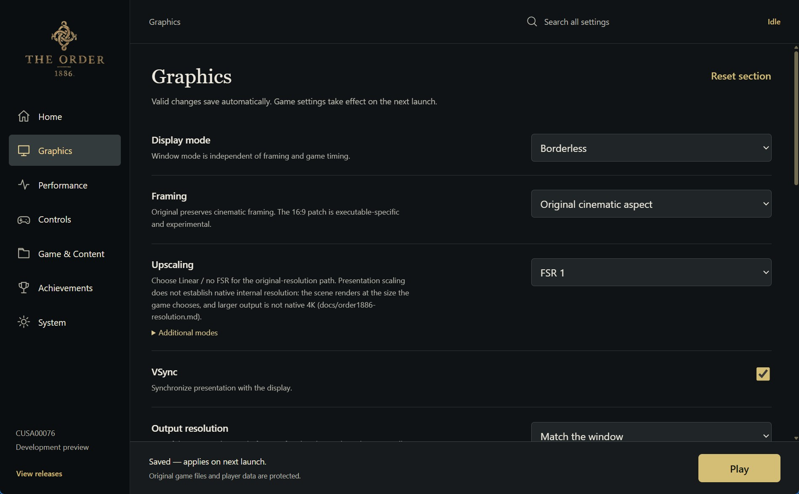</td>
    <td width="50%">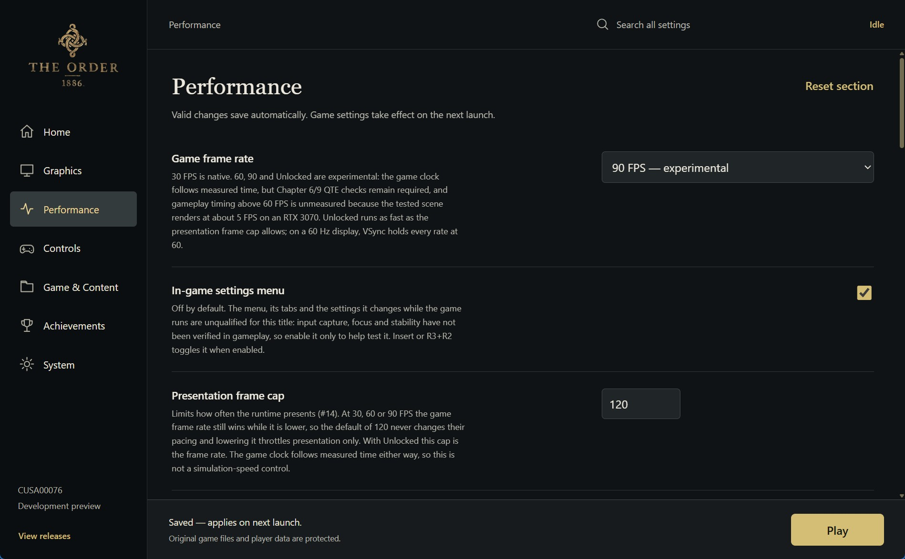</td>
  </tr>
  <tr>
    <td>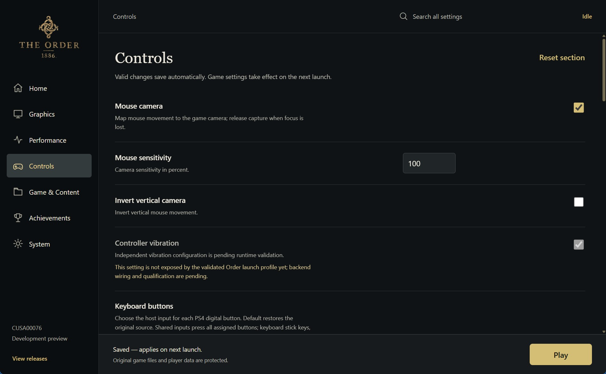</td>
    <td>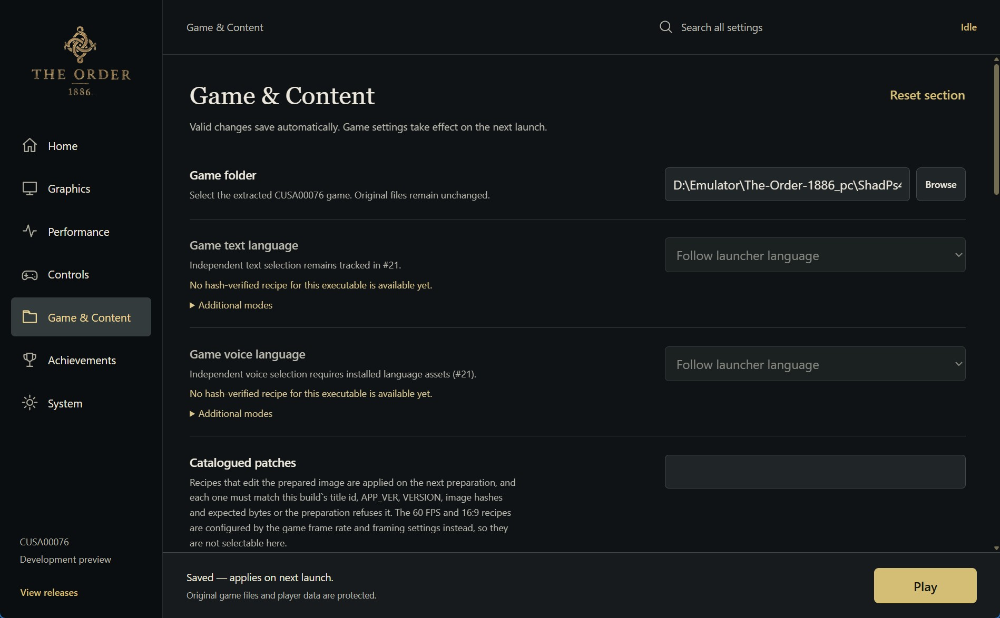</td>
  </tr>
  <tr>
    <td>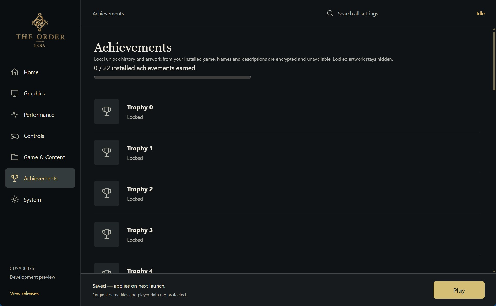</td>
    <td>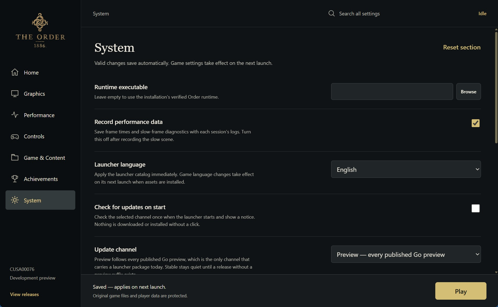</td>
  </tr>
</table>

| Page | Available controls |
| --- | --- |
| **Home** | Play, the launch configuration and the game installation check |
| **Graphics** | Display mode, framing, FSR 1/Linear, VSync, output resolution, sharpening, anisotropy and the four post effects |
| **Performance** | 30/60/90 FPS and Unlocked, the presentation cap, the in-game menu and overlay items |
| **Controls** | Mouse camera, sensitivity, inverted Y and keyboard bindings |
| **Game & Content** | Game folder, game language, catalogued patches, saves, mods, desktop shortcut and Add to Steam |
| **Achievements** | Earned trophies, read from the game's own trophy data |
| **System** | Runtime override, performance recording, launcher language, updates, logs and cache tools |

Use **Save settings** after editing; launching from a settings page saves its values. Navigation keeps unsaved edits, and **Escape** returns Home. The launch bar stays available on every page.

**Saves:** on Game & Content, select a backup and press Play to confirm restoration before launch, or use Restore selected backup. Current saves are backed up first; then choose Continue/Load in the game. Older snapshots may lack Profile or progress. Saves use the SFO’s `INSTALL_DIR_SAVEDATA=CUSA00035`; do not rename that folder to CUSA00076.

**Language:** save the choice on System and restart the launcher. The next game launch requests that PS4 system language, including Brazilian Portuguese. Matching game language assets must be installed; independent text/voice controls remain open.

For mouse look, open **Controls**: sensitivity and inverted Y persist. In the game window **Esc** releases the cursor and **F6** toggles capture; focus loss releases it automatically. This supplies the PS4 right stick; a direct 1:1 camera hook and remapping UI remain open. See the [input/direct-play guide](docs/order1886-input.md).

**Play The Order 1886.exe** starts with the same saved configuration, preparation and logs as Play. Keep it beside `_internal` and `bin`. Use **Game & Content → Add to Steam** with Steam closed; the action preserves existing shortcuts and is idempotent. Reopen Steam afterwards.

[Asset mod formats and limits](docs/order1886-mods.md) describe reversible `_data` overlays. Updates are installed manually; automatic updating, external executable patches, a Cheats page, independent game text/voice and a live Achievements page are not complete. The Tk window that used to be the fallback launcher has been removed; the Go launcher is the only one.

## Graphics and performance

**FSR 1** is spatial presentation scaling. **AMD FSR 3.1 (native AA) + FSR 1** replaces the game's own
temporal resolve at its render size, then FSR 1 scales to the output (Windows, from the next preview). **NVIDIA DLAA (DLSS at native size) + FSR 1** does the same on GeForce RTX GPUs; DLSS quality modes, which render below the output size, wait for render-target scaling. XeSS and FSR 4 follow. The 4K/60 target is **3840×2160 output with upscaling acceptable**,
preserved detail and sustained 60 FPS in gameplay. It has not passed.

**60 FPS, 90 FPS and Unlocked are experimental.** The 60 FPS recipe warns of possible
QTE softlocks in Chapters 6 and 9, and gameplay timing above 60 FPS has not been measured.
On a 60 Hz display, VSync holds every rate at 60. A host presentation rate or selected cap does not establish
that the game produces that many new frames. Use the 30 FPS baseline first.

## Known problems and reporting

| Problem | What to do |
| --- | --- |
| `Image exceeds device format limits`, `layers=8029/2048` | Preserve the boot log and matching `last-run.json`. Descriptor validation and targeted inactive-resource guards remain enabled. Keep the matching descriptor/shader evidence; the original crash is not closed by a timeout run. |
| Low or varying frame rate | Include the scene, settings, GPU/driver and matching log. Shader compilation and compatibility work remain in progress. |
| Runtime missing or identity rejected | Keep the complete package together, or build a matching runtime. Use System for an explicit runtime override. |
| Experimental 60/90 FPS or Unlocked timing problems | Return to 30 FPS and report the chapter and reproduction steps. |

Open **System → Open logs**. When
[reporting a problem](https://github.com/JulioCacko/The-Order-1886_pc/issues), include
`last-run.json`, the matching boot/session log, runtime SHA256, game metadata,
GPU/driver and reproduction steps. Review logs for personal paths before sharing;
do not upload game binaries or saves.

A previous instrumented session coincided with a full-PC freeze requiring a
reset; its cause remains unknown. The October 17 image assertion is separate
evidence and does not establish the cause of that freeze.

## Building from source

Follow the [Windows build guide](docs/order1886-build.md) and initialize its
required submodules. From PowerShell:

```powershell
& C:\msys64\usr\bin\bash.exe build.sh --test
out/order1886-pyenv/Scripts/python.exe -m unittest discover -s tests
```

After the native build succeeds, create the portable preview. The Go launcher is
the only launcher, and this builder packages it together with the payload from
source:

```powershell
./packaging/windows/order1886-go-build.ps1 -Runtime ./out/order1886-runtime.exe
```

The builder bundles the Go launcher (as both entry points), the dedicated
runtime with every DLL it imports, the worker the launcher drives, build identity
and license notices. The
[portable smoke verifier](packaging/windows/order1886-go-smoke.py) checks a
relocated package without starting gameplay. Build, CPU and smoke checks are
separate from graphics and gameplay acceptance.

## How it works

| Layer | Role |
| --- | --- |
| Loader | Prepares a hash-checked copy of the original executable and links its modules |
| Runtime | Reimplements the PS4 system interfaces used by this title |
| Video | Translates PS4 GPU commands and shaders to Vulkan/SPIR-V |
| Launcher | Configures the dedicated backend and manages sessions, logs and save backups |

## Credits and license

[GPL-2.0-or-later](LICENSE). Loader/build infrastructure derives from
[FelipePrado0/gow3_pc](https://github.com/FelipePrado0/gow3_pc); graphics/API work
derives from [shadPS4](https://github.com/shadps4-emu/shadPS4).
The five-page launcher structure is adapted from
[mateussmeneses/theorder1886-port](https://github.com/mateussmeneses/theorder1886-port).
README organization is inspired by [HayatoG/iss_pc](https://github.com/HayatoG/iss_pc).
Exact revisions and reuse decisions are recorded in the
[assessment](docs/order1886-reference-reuse.md); portable builds retain the
[attribution notice](packaging/windows/ATTRIBUTION-Order1886.txt).

The Order: 1886 belongs to its respective rights holders, including Sony
Computer Entertainment and Ready at Dawn. This project is not affiliated with
or endorsed by them. No game executable, dump or player save is distributed.
