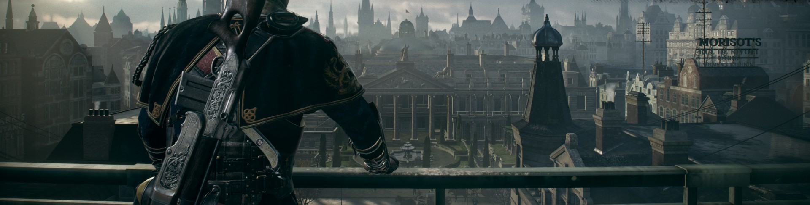
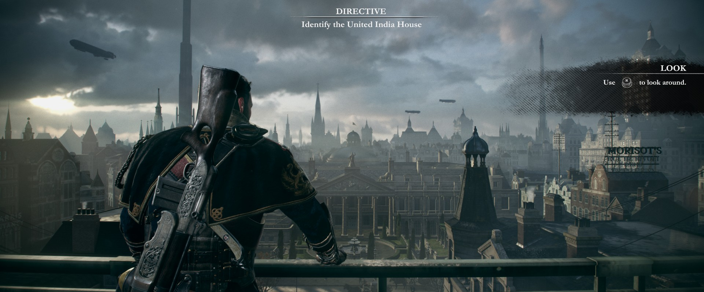
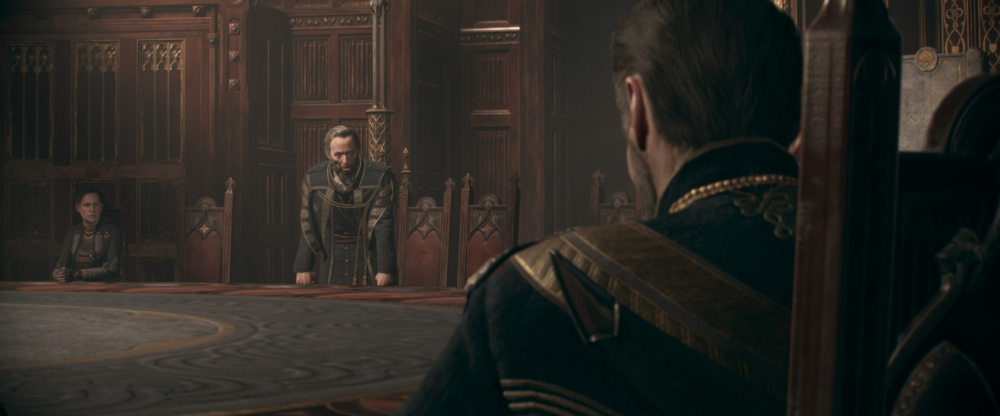

# The Order: 1886 para PC — runtime experimental de compatibilidade com PS4

[English](README.md) · **Português (Brasil)** · [Español](README.es.md)

Projeto comunitário que executa o binário x86-64 original de **The Order: 1886** no PC. As interfaces de sistema do PS4 são reimplementadas e um [núcleo de vídeo derivado do shadPS4](https://github.com/shadps4-emu/shadPS4) traduz comandos de GPU e shaders para Vulkan. O alvo é a atualização 1.02 em qualquer edição (**CUSA00076**, testada; CUSA00035, CUSA00070, CUSA00100, CUSA00670 e CUSA00785, experimentais), no Windows e no Linux x86-64.

> **Prévia de desenvolvimento.** A partir de um save do jogador, o pátio noturno roda a cerca de 53 FPS numa RTX 3070 (modo 60 FPS) e a luta no saguão do hotel fica em 38 FPS com quedas. Novo na v0.2.5: o jogo pode renderizar nativamente em até 4K, sem upscaler, a 30 FPS na mesma GPU. Progressão completa, estabilidade em sessões longas, o tempo dos QTEs dos capítulos 6 e 9 e 4K/60 sustentado ainda não foram aceitos.

> **Nenhum arquivo do jogo está incluído.** Você precisa da sua própria cópia extraída. Projeto comunitário não oficial.

## 4K nativo, sem upscaler

Novo na v0.2.5. Em Graphics → **Render resolution**, o próprio jogo desenha cada passo do tamanho da tela no tamanho escolhido; com 3840 de largura são 3840×1600 (ou 3840×2160 com enquadramento 16:9), apresentados 1:1. RTX 3070, modo 30 FPS.

<table>
  <tr>
    <td colspan="2"></td>
  </tr>
  <tr>
    <td width="50%"></td>
    <td width="50%"></td>
  </tr>
  <tr>
    <td colspan="2"></td>
  </tr>
</table>

A imagem de cima é a cena completa em 3840×1600, capturada do pacote Windows v0.2.5 numa janela sem bordas em uma tela 3840×2160. As duas do meio foram renderizadas em 3840×1600 e capturadas de uma janela 1920×1080. A comparação de baixo é um recorte 1:1. Medido em 3840×1600: 30 FPS na rua e no telhado do Capítulo I, com quedas para 27 FPS na cena do Conselho no Capítulo II. Os mapas de sombra e o MSAA mantêm os tamanhos originais, e por enquanto só a atualização 1.02 é suportada. [Evidência](docs/verification/2026-10-29-native-resolution.md).

## Gameplay no PC

Capturado do pacote Windows da prévia 9 numa RTX 3070 em 1920×1080, modo 60 FPS, recortado para a cena de 1920×800 que o jogo renderiza.

<table>
  <tr>
    <td width="50%"></td>
    <td width="50%"></td>
  </tr>
  <tr>
    <td></td>
    <td></td>
  </tr>
</table>

### Demonstração em vídeo

[**Assista à demonstração no YouTube**](https://youtu.be/wpNkwih0cxI), publicada por **Julio Cacko**.

## Baixar

**Download publicado: v0.2.5, de 29 de outubro.** Pacotes para Windows e Linux x86-64. Preserve a pasta `user` ao atualizar.

**[Baixar o pacote para Windows](https://github.com/JulioCacko/The-Order-1886_pc/releases/download/v0.2.5/order1886-go-windows.zip)** · **[Baixar o pacote para Linux](https://github.com/JulioCacko/The-Order-1886_pc/releases/download/v0.2.5/order1886-linux-x86_64.tar.gz)** · [Notas da versão](https://github.com/JulioCacko/The-Order-1886_pc/releases/tag/v0.2.5) · [Manual de instalação](https://github.com/JulioCacko/The-Order-1886_pc/releases/download/v0.2.5/QUICKSTART.txt)

Os pacotes trazem o launcher, o runtime dedicado e as bibliotecas necessárias. Não precisa de Python, MSYS2 ou compilador. Os arquivos “Source code” do GitHub são para desenvolvedores.

**Windows**

1. Extraia o ZIP inteiro para uma pasta com permissão de escrita. Mantenha os executáveis e a pasta `bin` juntos.
2. Leia **QUICKSTART.txt** e abra **The Order 1886.exe**.
3. Escolha a pasta do jogo extraído (qualquer nome). Ela precisa conter `eboot.bin`, `sce_sys`, `sce_module`, `_data` e `archivemap.bin`.
4. Comece com **30 FPS** ou **60 FPS**, escolha o modo de exibição e pressione **Play**.

**Linux x86-64**

Extraia o `tar.gz` e execute `The Order 1886`. Requer driver Vulkan e glibc 2.39 ou mais recente. A janela do launcher também precisa de GTK 3 e WebKitGTK 4.1; sem eles, `Play The Order 1886 --game-dir /caminho/do/jogo` inicia o jogo diretamente (SteamOS e Steam: veja `QUICKSTART.txt`). Gameplay num driver de GPU no Linux ainda não foi testado.

Os arquivos originais do jogo não são alterados. Imagens preparadas, configurações, cache, logs, saves e backups ficam na pasta `user/order1886` da instalação.

## Novidades

**v0.2.5 — 29 de outubro de 2026.** **Resolução nativa até 4K sem upscaler** (#3, #128): Graphics → Render resolution oferece Original, 2560, 3840 ou uma largura personalizada, e o jogo desenha cada passo do tamanho da tela nesse tamanho. **Sem bordas não vira mais tela cheia exclusiva** no Windows (#121, #125). **O Linux roda dumps com pastas em maiúsculas e minúsculas misturadas** (#124). O TOport recebe crédito pelas correções do renderizador portadas dele (#112, #123). [Notas da versão](https://github.com/JulioCacko/The-Order-1886_pc/releases/tag/v0.2.5)

**v0.2.4 — 28 de outubro de 2026.** O pacote Linux inicia sem WebKitGTK 4.1, por exemplo no SteamOS (#114); `Play The Order 1886` inicia o jogo direto e `--game-dir` define a pasta do jogo. [Notas da versão](https://github.com/JulioCacko/The-Order-1886_pc/releases/tag/v0.2.4)

**v0.2.3 — 28 de outubro de 2026.** 60 FPS, 16:9 e as outras opções experimentais funcionam com a atualização 1.02, e as seis edições do jogo são aceitas (#113). [Notas da versão](https://github.com/JulioCacko/The-Order-1886_pc/releases/tag/v0.2.3)

## O launcher

<table>
  <tr>
    <td width="50%"></td>
    <td width="50%"></td>
  </tr>
  <tr>
    <td></td>
    <td></td>
  </tr>
</table>

| Página | Controles |
| --- | --- |
| **Home** | Play, a configuração de início e a verificação da instalação do jogo |
| **Graphics** | Modo de exibição, enquadramento, resolução de renderização (nativa até 4K), FSR 1/Linear, VSync, resolução de saída, nitidez, anisotropia e os quatro efeitos de pós-processamento |
| **Performance** | 30/60/90 FPS e Unlocked, limite de apresentação, menu no jogo e itens do overlay |
| **Controls** | Câmera pelo mouse, sensibilidade, Y invertido e teclas |
| **Game & Content** | Pasta do jogo, idioma do jogo, patches catalogados, saves, mods, atalho na área de trabalho e Add to Steam |
| **Achievements** | Troféus obtidos, lidos dos dados do próprio jogo |
| **System** | Runtime alternativo, gravação de desempenho, idioma do launcher, atualizações, logs e cache |

No jogo, **Esc** libera o cursor e **F6** alterna a captura. [Guia de entrada e início direto](docs/order1886-input.md). Estrutura de páginas adaptada de [mateussmeneses/theorder1886-port](https://github.com/mateussmeneses/theorder1886-port).

## Estado e desempenho

**60 FPS, 90 FPS e Unlocked são experimentais.** A receita de 60 FPS avisa de possíveis travamentos em QTEs nos capítulos 6 e 9. Numa tela de 60 Hz, o VSync segura qualquer taxa em 60. A meta 4K/60 (saída 3840×2160, upscaling permitido, 60 FPS sustentados em gameplay) ainda não foi atingida; a renderização nativa em 4K chega a 30 FPS.

Leia o [estado atual completo, em inglês](docs/STATUS.md) e o [plano 4K/60](docs/order1886-4k60-verification.md).

## Problemas, créditos e licença

Abra **System → Open logs**. Ao [relatar um problema](https://github.com/JulioCacko/The-Order-1886_pc/issues), inclua `last-run.json`, o log de sessão correspondente, o SHA256 do runtime, os metadados do jogo, GPU/driver e os passos para reproduzir. Remova caminhos pessoais; não envie arquivos do jogo nem saves.

[GPL-2.0-or-later](LICENSE). Infraestrutura de carregamento e build derivada de [FelipePrado0/gow3_pc](https://github.com/FelipePrado0/gow3_pc); trabalho de gráficos e APIs derivado do [shadPS4](https://github.com/shadps4-emu/shadPS4). Correções do renderizador (trava da tabela de memória, leituras adiadas, draw pipe, bias de profundidade nos redesenhos e o diagnóstico do HTILE) vêm do TOport, [IgorAugustoHH/The-Order-1886-PC-Port](https://github.com/IgorAugustoHH/The-Order-1886-PC-Port) (GPL-2.0). Organização do README inspirada em [HayatoG/iss_pc](https://github.com/HayatoG/iss_pc). The Order: 1886 pertence aos seus detentores, incluindo Sony Computer Entertainment e Ready at Dawn; este projeto não é afiliado nem endossado por eles.
