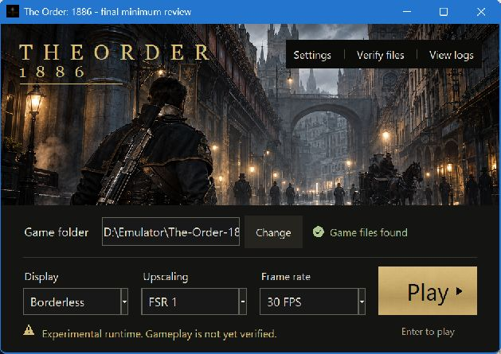

# The Order: 1886 PC — current development status

Updated **16 October 2026**. This report describes the Order-specific Windows launcher and PS4 compatibility runtime. **The game is not verified playable, and the 4K/60 FPS target has not passed.** Local builds and host checks are development evidence, not gameplay certification.

## What is implemented

- A dedicated CUSA00076 backend/runtime and SHA256-bound build identity, with title-specific state outside the original game directory.
- A native Windows Tkinter launcher with a cinematic artwork area and anchored launch bar. Game folder, display mode, FSR 1/Linear presentation and frame-rate selection are immediately available; Play/Stop is the primary action. Advanced settings, verification and logs remain accessible.
- Native keyboard controls, settings persistence, explicit error states, asynchronous session output, cancellation, and recovery of detached/invalid standard handles.
- Original-file protection, prepared-image isolation, save backups, and descriptor-based save timestamps through the production kernel/POSIX resolver.
- Guest-output FPS reporting separate from host presentation rate, FSR 1 presentation, and a hash-guarded, opt-in experimental 60 FPS preparation profile.
- Graphics/resource validation, serialization and array-layer fixes, bounded SRT diagnostics, and a serial submission baseline. Unsupported descriptor cases still fail explicitly rather than guessing values.
- A portable Windows builder with dependency/license collection, source and file manifests, and a relocated-package verifier that does not start gameplay.

The active Order path no longer relies on another game's injection hooks, patch tables, scene/object reconstruction or timing assumptions. Required attribution and historical provenance remain. This separation does not establish compatibility with The Order's engine.

## Launcher screenshots

These are captures of the actual updated source launcher during UI review, not gameplay or generated UI mockups. The background illustration and brass texture are generated design assets; all functional text and controls are rendered separately. The selected FPS value is configuration, not a benchmark. Windows capture reports logical dimensions of 1027 × 682 and 629 × 445 for the reviewed 1536 × 976 and 940 × 620 client sizes respectively.

The user approved the [cinematic launch-bar concept](../.impeccable/mocks/concept-a.png). [DESIGN.md](../DESIGN.md) and [PRODUCT.md](../PRODUCT.md) record the implemented system and constraints.

## Acceptance gates

| Gate | Current result | Evidence and limit |
| --- | --- | --- |
| Native build | Passed locally | Existing runtime receipt and eight retained native CPU checks; no native runtime code changed in the launcher delivery |
| Python and launcher | Passed locally | 167 tests run, 11 skipped; final visual fixes followed by 11 launcher tests and the GUI smoke check |
| Portable host/package | Passed locally | All 12 relocated CPU/bootstrap/preparation checks; 1308 manifest file hashes and ZIP CRC verified |
| Boot | Partial | Original executable reaches intro and an animated background; not a complete in-game route |
| Menu | Unverified | User reports reaching New Game/Continue, but legible menu text and repeatable input behavior have not been accepted by this verification |
| Save initialization | Observed | Mount, metadata update, unmount and dialog close succeeded; existing save reopened on a second boot |
| Gameplay and progression | Unverified | No representative interactive 3D route or checkpoint progression accepted |
| Stability | Unverified | Two 120-second recovery runs reached their timeouts; no 30-minute gameplay run |
| 4K/60 FPS | Unverified | 3840 × 2160 output with upscaling is acceptable to the user; no accepted representative 4K/60 measurement |
| GitHub Actions/release | Unverified | No workflow runs or releases were returned by the repository checks during this delivery; local verification is separate |
| Automated design fidelity | Open | Native screenshots and source were reviewed, but the web-oriented hero gate remains failed/open under Windows capture scaling and native-control differences |

The 167-test run followed the launch-bar behavior changes. The final lettering, material and indicator batch was then checked by the focused launcher suite, GUI smoke test and frozen-package verifier. Eleven skipped tests are reported as skipped, not passed. The eight native checks refer to the retained earlier runtime build; they were not rerun for documentation or launcher-only changes.

## Current build and package identity

The native runtime is unchanged by this launcher delivery:

| Field | Value |
| --- | --- |
| Runtime SHA256 | `b6db10c4284d041275820b34f04c3b2748427a37e942e57e86a3d1ba760d0557` |
| Runtime ABI | `order1886-native-1` |
| Prepared format | `PS4BOOT5` |
| Renderer / cache ABI | `native-ps4` / `native-ps4-v1` |
| Shader binary / metadata / pipeline key | 13 / 10 / 8 |
| Native receipt source revision | `7e6d2a31f0c10964b493caadc515ca80274c6b67`, dirty snapshot recorded at build time |
| Toolchain | MSYS2 CLANG64, Clang 22.1.8; RelWithDebInfo, LTO and PGO off |
| Local test hardware | Ryzen 5 5600X, RTX 3070; this is not a validated minimum requirement |
| New local package build ID | `20261016T201135Z-b6db10c4284d` |
| ZIP bytes | 103917546 |
| ZIP SHA256 | `0f58845e04f2e765813ec21ccd17c59bc89018a53e0f1cb811e689c2a3769021` |
| Launcher EXE SHA256 | `131e896dd564a797831856f07bddb894411fdd99beaaac55055ca26207137af6` |

Local executable: `dist/order1886/20261016T201135Z-b6db10c4284d/The Order 1886/The Order 1886.exe`. Archive: `dist/order1886/20261016T201135Z-b6db10c4284d/order1886-windows.zip`. These generated files are intentionally outside Git; this report does not imply a public download was published.

The package manifest's launcher-source hash matches the current source used for packaging. All 1308 listed installed files match their hashes, the ZIP passes CRC validation, and the archived and installed manifests are equal. The package contains generated launcher illustration, not an extracted game dump or player state. The [committed delivery receipt](verification/2026-10-16-delivery.json) provides a portable summary without uploading local logs or game data.

## Real-game evidence and unresolved blockers

### Save creation and reopening

The earlier save-creation stop identified the missing `sceKernelFutimes` import `NLq2b1jOaN0#libkernel`. The implementation now uses descriptor-based timestamps with microsecond precision, read-only descriptor support, error mapping and original-file protection. Kernel/POSIX resolver coverage includes the three relevant NIDs.

The first recovery run completed save mount, metadata update, unmount and dialog close and left a 102400-byte `SYSTEM.DAT`. A second boot found and mounted the existing save, then unmounted successfully. This proves initialization/reopening on those runs, not gameplay checkpoint save/load or progression.

Both runs used copied user state, Windowed FSR 1/30, a 120-second host timeout, and harness overrides disabling pipeline cache and Vulkan validation. Neither had a debugger, RenderDoc or ETW recorder attached. Both ended at timeout without a new PC freeze or import/assertion stop. Those overrides differ from the normal packaged cache policy.

### Rendering and performance

The recovery evidence shows intro/animated background output and the guest-output FPS panel. Cold compilation dropped some reported frame windows to approximately 13–18 FPS. These are startup observations, not a controlled gameplay benchmark, native-resolution comparison or 4K result.

An earlier cached run stopped at an ordinary pointer in fragment shader `a916827f`. Static analysis shows a zero low mask can make that pointer unused, but the failing draw's mask was not captured. No ordinary-buffer bypass was added; the assertion and flattened-input diagnostic remain. Earlier FMask/SRT and integer-filtering failures are preserved in the [historical runtime record](order1886-runtime-status.md).

The agreed [4K/60 acceptance plan](order1886-4k60-verification.md) requires preserved scene detail, representative gameplay and timing checks, including Chapters 6 and 9. Merely selecting 60 FPS, presenting at 60 Hz, validating SPIR-V or displaying an intro does not pass it.

### Prior PC freeze

The user confirmed a full-PC freeze requiring a manual reset. Windows recorded an unclean restart with bugcheck code 0. A retained user-process snapshot shows debug-heap SPIR-V validation during pipeline-cache warmup; it is not a kernel crash dump. Protected Windows dump directories were inaccessible, so their contents are unknown. The root cause has not been established.

Do not infer a confirmed GPU-driver, hardware or emulator cause from that evidence. No game, GPU profiling or instrumented reproduction was launched for this repository/launcher delivery. RenderDoc, Ghidra, WinDbg and ETW integration are diagnostic tools, not evidence that a useful GPU capture, kernel dump or completed ETL recording exists.

## Verification evidence

| Check | Local evidence path |
| --- | --- |
| Full Python suite | `out/order1886-evidence/repository-evolution-python-tests.log` |
| Retained native build/checks | `out/order1886-evidence/post-freeze-native-checks.log` |
| Save initialization | `out/order1886-evidence/save-start-b6db10c4-plain-after-reset/logs/20261016T184023.425349Z-boot.log` |
| Existing-save reopening | Same directory, `20261016T184423.157835Z-boot.log` |
| New portable verifier | `out/order1886-evidence/repository-evolution-portable/Portable Smoke 489133db9e/smoke-report.json` |
| Prior freeze recovery | `out/order1886-evidence/crash-recovery-20261016.md` |
| Native screenshot review | [Launcher review and limitations](verification/2026-10-16-launcher-review.md) |

These local evidence paths describe retained artifacts; ignored local directories are not claimed to be included in a clone. The committed delivery receipt and screenshots are the shareable summary.

## Project evolution

| Commit / delivery | Change |
| --- | --- |
| `7e16a1d` | Established the Order-specific runtime, backend, launcher and build path |
| `0d269f7` | Added experimental 4K/60 preparation and graphics/runtime guards |
| `7e6d2a3` | Implemented save timestamps, guest-output FPS and additional resource guards |
| `7863d74` | Recorded save-recovery and portable-preview verification |
| `30158a9` | User-approved launch-bar composition, native quick settings, generated visual assets, focused regressions and frozen package |
| Current repository documentation | Replaced inherited localized product claims, updated About/topics/homepage, added this status report and evidence receipt, and corrected issue templates |

Prior implementation commits remain intact; the current work is committed in separate launcher and repository-documentation changes. Runtime identity records retain their original build-time revision rather than being relabelled as newly compiled code.

## Next acceptance work

1. Reproduce the in-game menu and save-start transition with matching source/package identity, retained saves and bounded execution. Compare normal cache policy with the documented recovery overrides.
2. Resolve the first concrete renderer/SRT failure with captured descriptor/mask evidence; preserve explicit failures rather than bypassing them.
3. Establish a representative interactive 3D route, input/audio behavior, checkpoint save/load, restart and progression.
4. Complete a recorded 30-minute stability run before making stability claims.
5. Measure cold/warm runs on that route at baseline and 3840 × 2160 output; verify guest-output FPS, frame pacing, detail and timing before claiming 4K/60.
6. Validate broader Windows/DPI configurations, close applicable design-review gates, and run the repository workflow before treating the local package as a release candidate.
