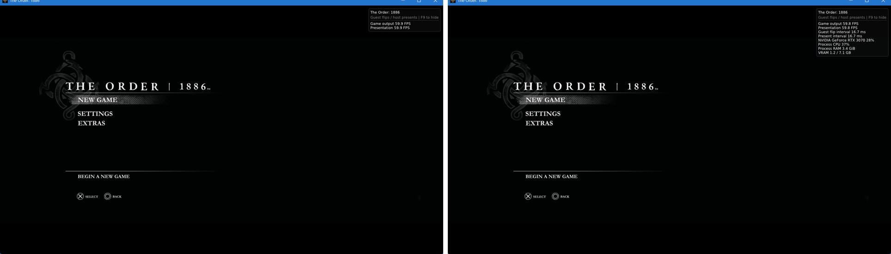
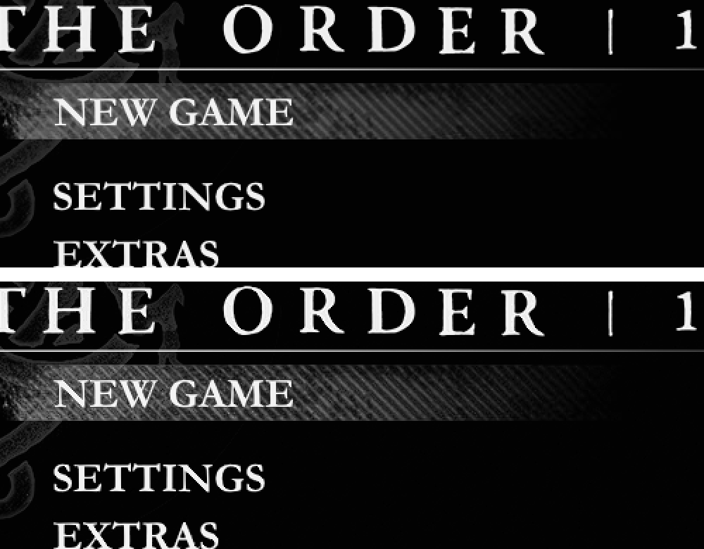

# Graphics step 1: in-game evidence for the newly wired options

Branch `graphics/step1-cheap-wiring` (base `0dc552f`). Runtime SHA256
`e3dc2081bd8a92c43ab752352967883e2557d97d19cb0540bafaf3df424eb24a`, RTX 3070 (driver 617.14),
Windows 11, base game CUSA00076 APP_VER 01.00. Captured on 20 October 2026.

## Method

`tools/order1886_step1_evidence.py` runs `tools/order1886_graphics_probe.py` once per variant.
Every run uses the same steps:

- an isolated state with no player files and a new cold GPU cache;
- the 60 FPS profile in a window;
- Space (Cross) pressed 45 s after launch, which opens the title menu;
- frame dumps and a desktop screenshot at 52 s and 58 s;
- the native frame trace, with the row cut off by the 62 s timeout dropped.

The first run is the launcher defaults. A second run with the same defaults measures run-to-run
noise: its output frames differ from the first by a mean of 0.057/255 (PSNR 60.6 dB). A
difference counts only above that.

The warm-up variants need cached pipelines, so they ran again from a copy of the first run's
cache (116 pipelines). Each of those runs has its own warm baseline.

Raw dumps, logs, traces and full screenshots are in `out/order1886-evidence/step1/`, which Git
does not track. The full screenshots show the whole desktop. Only the cropped game-window images
below are committed.

## Results

| Option | Runtime log line | Measured effect | Verdict |
| --- | --- | --- | --- |
| Output resolution | `output 1280x720` / `output 2560x1440` | Output frames dumped at 1280×720 and 2560×1440; the default dumps at 1920×1080 | Works |
| Sharpening 100 | `sharpening on (100)` | Output differs from defaults by 0.232/255 mean, PSNR 44.3 dB (noise: 0.057, 60.6 dB). The guest image is unchanged (0.056). | Works |
| Overlay items | `overlay items 0x1` / `0x7b` | Frame time, GPU, CPU, RAM and VRAM lines appear only when on (image below) | Works |
| Frame cap 45 (in-game menu on) | — | 44.37 FPS, p50 22.25 ms; default cap: 58.77 FPS, 16.61 ms | Works |
| Deferred image readbacks | `deferred image readback enabled` (default: `disabled`) | No frame-time change on the title menu or in gameplay | Consumed; no measured effect |
| Frames queued 0 / 2 | `frames queued 0` / `2` | No frame-time change on the title menu (VSync Fifo). Latency was not measured. | Consumed; effect not measured |
| Async shaders | `async shaders 1` | Cold cache: worst frame 209 ms against 455 ms (one run each). Warm cache: no change. | Consumed; a startup crash it exposed is fixed (see below) |
| Background warm-up | `Pipeline warm-up: loading in the background (6 threads)`; 94 of 116 in 2.04 s | Default warms all 116 before the first frame (2.43 s). Background: 3604 guest flips in the window against 3445–3472, worst frame 157 ms against 63 ms | Consumed; earlier first frame, one longer hitch |
| Parallel warm-up | `116 of 116 pipelines in 1.48 s (6 threads)` (default 2.43 s, 0 threads) | Warm-up 39% faster, but p99 33.1 ms and 25 frames over 33 ms against 20.5–21.4 ms and 9–11 | Consumed; worse frame pacing in this run, keep unqualified |
| Anisotropy 16× | `anisotropy 16` | No difference on the title menu (no angled 3D surfaces); gameplay ground detail up 3–8% (see Gameplay) | Works, small effect |

## Gameplay (21 October 2026)

At first the gameplay scene could not be captured. At the player's latest save, both the step-1 runtime and a
runtime built from base `0dc552f` without step 1 (SHA256 `2ef61708…`) showed a flat sky-blue
frame. The release runtime from `54242e0` (SHA256 `ca77edaf…`) rendered the scene. A bisect traced
this to 7cf249a, where the default `ORDER1886_HTILE=0` also turned off the metadata-clear skip,
so depth was never cleared. The fix is
[#88](https://github.com/JulioCacko/The-Order-1886_pc/pull/88). It is merged locally into this
branch for these captures, and the merged runtime's SHA256 is
`1eeb0bdc6d446b53188194eb23671640568b28394110e3fac473c1539a6b5247`.

These runs use a copy of the player's savedata. Space is pressed at 45 s for the title menu
and at 53 s for Continue. The game loads to a courtyard where the player stands still. Frames are
dumped at 150, 170 and 190 s, and frame times count from 100 s into the trace (about 98 s of
gameplay per run). Two cold-cache passes and two warm-cache passes each repeat the defaults. The
warm passes start from a copy of the first cold baseline's cache (504 pipelines).

| Option | Gameplay result |
| --- | --- |
| Defaults (8 runs) | 6.97–7.92 FPS, p50 125–144 ms. The scene runs at about 7 FPS whatever the setting, which matches the reported Chapter 2+ slowdown (#3). |
| Anisotropy 16× | Ground-region detail (mean absolute Laplacian of the guest image over three frames) is 1.039 and 1.038 in the two passes, against 0.956–1.007 for the four default runs. The increase is small (3–8%) but beats the run-to-run spread in both passes. The camera is not pixel-identical between runs and the scene is dark, so no committed image shows it. |
| Deferred image readbacks | 7.00 and 7.06 FPS against defaults of 6.97–7.27. No change. |
| Frames queued 2 / 0 | 7.07 / 6.75 FPS (2) and 7.18 / 7.00 FPS (0). No change outside the noise. Latency was not measured. |
| Async shaders | No frame-time change (cold 6.88 FPS; warm 7.94 / 7.76 FPS). One of four async runs crashed 1.7 s after launch; the cause and fix are below. |
| Background warm-up | The game starts while 472–473 of 504 pipelines load in about 9 s on 6 threads. The defaults block for 8.75–11.32 s on one thread. Gameplay frame times do not change. |
| Parallel warm-up | All 504 pipelines in 7.44–7.56 s on 6 threads, against 8.75–11.32 s. Gameplay frame times do not change. |

## Async shaders startup crash (21 October 2026)

With async shaders on, about one launch in 17 crashed 1–2 s after start. The crash site was never
the same twice: `IR::Block::~Block`, then `IR::Inst::~Inst` (both inside `Pools::ReleaseContents`
on the GPU thread), then `IrqController::Register` inside `sceGnmAddEqEvent` on a game thread.
Damage in three unrelated structures pointed to heap corruption, not to the shader compiler. A
temporary guard confirmed that no second thread ever entered `CompileModule`.

The cause is a data race in `Platform::IrqController` (`gpu/shadps4/core/platform.h`). Every
call looked up its per-interrupt context with `try_emplace` on one shared `unordered_map`, with no
lock. Only the context itself was locked. Game threads call `Register`, and the GPU thread calls
`Signal` for end-of-pipe, flip and idle. When both reached a new interrupt id at once, one insert
could rehash the map under the other and corrupt the heap. Async compilation lets the GPU thread
signal its first interrupts while the game is still registering them, which is why the crash
showed up only with that option.

The fix keeps one context per interrupt id in a fixed array that is created up front. Lookups
never insert, so nothing can grow under another thread.

- `tests/test_irq_controller.cpp` registers and signals ten interrupt ids from two threads on
  2000 fresh controllers. Before the fix, 10 runs gave 5 passes, 3 access violations, one
  `0xC0000374` (heap corruption) and one hang. After the fix, 20 of 20 runs pass. It is part of
  `bash build.sh --test` (56 native checks).
- In-game launch loop (copied save, 60 FPS profile, async shaders on, 8 s per launch): crashes on
  launches 17 and 18 before the fix, and 60 of 60 clean launches after it. With async off, 68
  launches ran clean before the fix.
- The native fault handler now writes a minidump of every thread when `ORDER1886_FATAL_DUMP` is
  set (`tools/order1886_graphics_probe.py --fatal-dump`). That is how the stacks above were
  obtained.

## Still open

- Frames queued needs an input-latency measurement; frame time alone cannot show it.
- Anisotropy needs a brighter scene or a pixel-matched camera for a visible image.
- Background warm-up leaves about 31 of 504 pipelines unloaded when it finishes; the cause is
  not investigated.
- At about 7 FPS this courtyard is the slow-scene capture #3 asked for. None of the step-1 options
  changes it.
