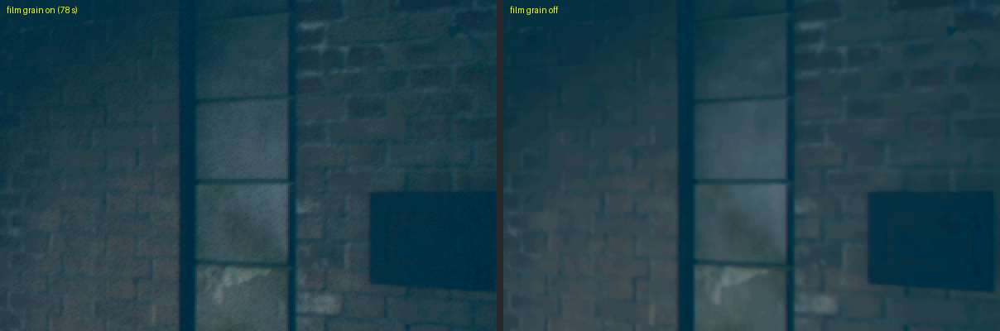
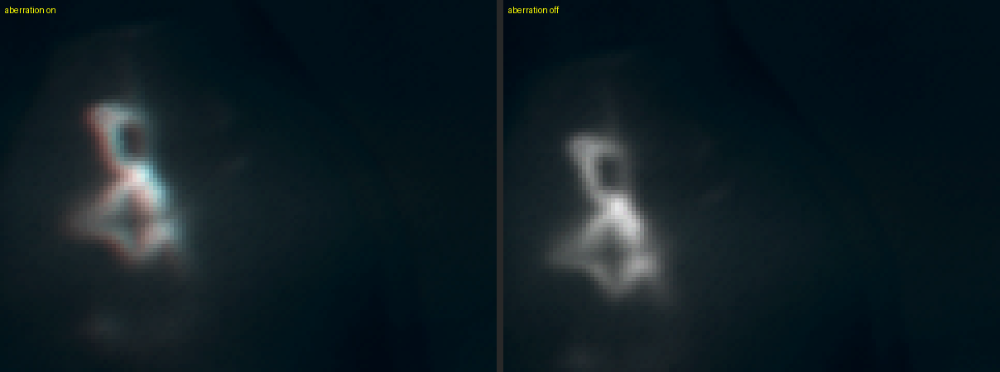
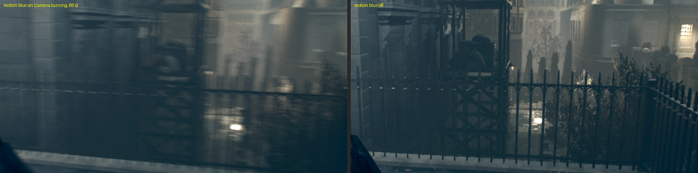
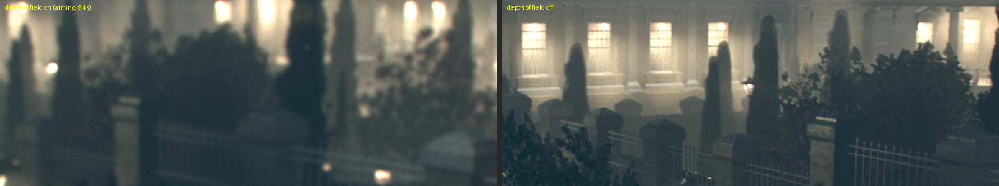

# Graphics step 10: real post-effect switches (#16)

Branch `graphics/step10-effect-toggles` (base `graphics/step1-cheap-wiring`, `9d951cd`). Runtime built
from that base, SHA256 `52000c315c6e13a7fa2567cee4c1f8281bb647ad924f6c7049c6ac4671ea8ac0`
(`bash build.sh --test`: "Native checks passed: 56"). RTX 3070 (driver 617.14), Windows 11, base
game CUSA00076 APP_VER 01.00 / VERSION 01.03. Captured on 21 October 2026.

## What the launcher offers now

| Setting | Located in the executable | Measured effect when off |
| --- | --- | --- |
| Film grain | Lens grain strength (`CFilmGrainParams` +4, lens+0x224; alternate lens+0x360) | Background high-frequency energy halves (below) |
| Motion blur | Lens motion-blur amount (lens+0x14c), which becomes constant-block+0x380 and gates the motion-blur pass | Camera-turn smear gone |
| Depth of field | Lens DOF amount (lens+0x398, alternate lens+0x22c) and the DOF constants (constant-block+0x30c/+0x44c) | Aiming blur gone |
| Chromatic aberration | RGB shift (lens+0x3bc, alternate lens+0x36c) copied to constant-block+0x320 and +0x5c0 | Red/cyan edge fringes gone |
| Model detail | Not located: removed | — |

All four are on by default (the original image). Off edits the prepared copy of the executable
through `scripts/order1886_post_effects.py`. The edit is hash-gated, the same way as the 60 FPS
and 16:9 recipes. It runs only when the SELF, the decoded ELF, the build metadata and every expected
instruction match. It keeps instruction lengths and never touches the game folder.

## How the effects were located

The binary was analysed in Ghidra 12.1.4 (headless, through the GhidraMCP backend) on the decoded
ELF, SHA256 `65cd8eaf…`.

- `fde_ca47c0` runs the full-screen effects pass. It names its passes with the strings
  `Motion Blur`, `Depth of Field Disabled`, `Bloom` and `Tone Mapping`. Motion blur runs only while
  the constant block's +0x380 is above 0. Otherwise the pass-through variant runs. Depth of field
  runs while the lens amounts (or the fog blur terms) are above 0. Otherwise the "Depth of Field
  Disabled" downsample runs.
- `fde_8ff3b0`, the lens-parameter constructor, registers the reflected types at their offsets:
  `CMotionBlurParams` at 0x148, `CFilmGrainParams` at 0x220, `CAltDOFParams` at 0x22c,
  `CAltFilmGrainParams` at 0x35c, `CAltChromAberParams` at 0x36c, `CDOFParams` at 0x398 and
  `CChromAberParams` at 0x3bc.
- `fde_834930` clamps the blended lens each frame. `fde_81dc90` then copies the lens into the
  post-processing constant block that the shaders read. The film-grain constants sit next to the
  per-frame random grain offsets.

Each switch replaces one load or clamp of the effect's strength with a zero (`vxorps`/`xor` plus
NOP padding). The game then takes the path it already uses when a lens has no such effect.

Model detail: the only level-of-detail control found is the frame-capture option `-capturenolod`.
It sets render-settings +0x5c, and no reader of that field was located. The renderer has no
distance or bias control to switch, so the setting was removed rather than left as a placebo.

## Method

`tools/order1886_step1_evidence.py` runs one graphics-probe run per variant: the defaults, a
repeat of the defaults, and each effect off. Each run uses an isolated state, a cold GPU cache and
a copy of the player's Chapter XI savedata (*The United India House*). Space is pressed at 45 s
and 53 s (title, then Continue). The game loads to the chapter start with Grayson standing still.

Two additions make the runs trustworthy:

- **Live strength reads.** `tools/order1886_post_effect_probe.py` (enabled with
  `--sample-effects`) uses ReadProcessMemory on the runtime under test, which executes the guest
  image natively. At every frame-dump delay it reads the lens block (pointer at RVA 0x16da6c0) and
  the constant block (pointer at RVA 0x170db70). It writes nothing.
- **Only the runtime under test.** Another session's runtime was open throughout. The key taps
  and the reader used to match the executable by name, so they reached that window. That is why
  earlier runs missed Continue or wandered the menu. Both now match the full executable path.

Held keys (`--keys 84:right:4 90:r:7`) turn the camera (arrows are the right stick) and then aim
(R is L2), for the two effects that need motion or focus.

Raw dumps, logs and samples are in `out/order1886-evidence/step10/` (`ch11-sampled2` static,
`ch11-motion` turning and aiming), which Git does not track.

## Live strengths (Chapter XI start)

| Field | Defaults (both runs) | Variant with that effect off |
| --- | --- | --- |
| Motion blur, constant +0x380 | 0.5 | 0.0 |
| Depth of field, constant +0x30c / +0x44c | 0.1 (0.18 while aiming) | 0.0 / 0.0 |
| Film grain, lens (0x220, 0x224, 0x228) | (0, 0.358, 0.914) | (0, 0, 0.914) |
| Chromatic aberration, active RGB shift +0x5c0 | (−0.5, 0.2, 0.3) | (0, 0, 0) |

Every off variant zeroes its own strength and leaves the others at the default values. A
first grain recipe zeroed field 0x220, and this read showed that field is already 0 in play. The
strength is 0x224, and the recipe now zeroes that field.

## Image results

Run-to-run noise between the two default runs is 0.47–1.01/255 mean absolute difference per
capture.

| Effect off | Metric | Off | Effect-on runs |
| --- | --- | --- | --- |
| Film grain | Background high-frequency energy, static (`ch11-sampled2`) | 0.469 | 0.928, 0.953 (defaults); 0.78–1.06 (other variants) |
| Chromatic aberration | Radial red-blue shift at the left and right edges, px | 0.04 | 0.67, 0.67 (defaults); 0.52–1.14 (other variants) |
| Motion blur | Horizontal/vertical gradient ratio while turning (86 s, 87 s) | 1.015, 1.032 | 0.80–0.83 |
| Depth of field | High-frequency energy of the far facade while aiming (94 s, 96 s) | 2.24, 2.13 | 1.85–1.90, 1.68–1.73 |

The film-grain-off run is left out of the on columns for the last two rows, because grain itself
adds gradient energy. Camera positions are not pixel-identical between runs, so the metrics are
statistics over regions, not frame differences.

## Tests

- `tests/test_order1886_post_effects.py`: each effect changes only its own sites, and one bad
  site leaves the image untouched. Reapplication, an original path, a stale recipe, an unknown
  effect (including `model_detail`) and the wrong APP_VER are refused. The catalogue offers
  exactly the four effects. A turned-off effect reaches `--disable-effects`, and the setting
  round-trips through the worker. When the game is present, every expected instruction matches
  the real executable.
- `python -m unittest discover -s tests`, and `bash build.sh --test` (56 native checks).

## Still open

- Gameplay with an effect off is unqualified beyond this chapter start. The edits run in every
  frame's lens update, so a cutscene with its own lens values should show the same result. That
  was not captured.
- Depth of field off also removes any BlurAmountOffset a lens adds. Fog blur still runs when a
  lens asks for it.
