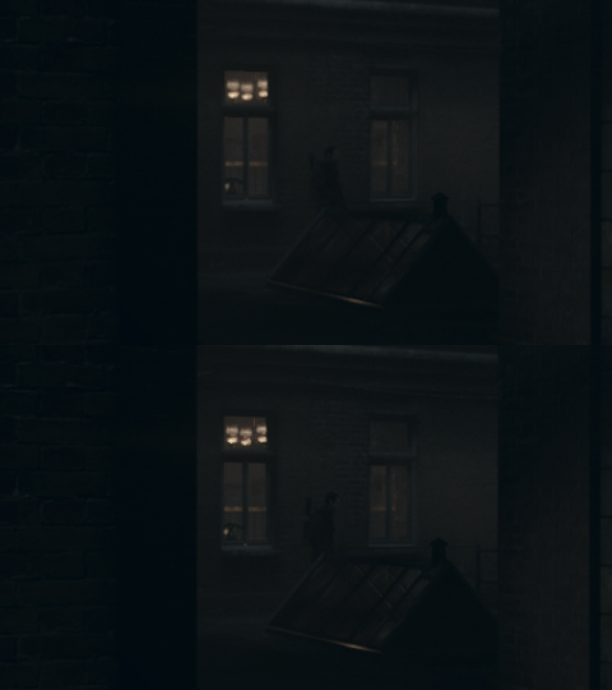

# Graphics step 2 evidence: temporal inputs and a provider in place of the resolve (#7)

Hardware: RTX 3070, Windows 11. Runtime SHA256 `6aae4457…`, provider `order1886_fsr3.dll`
SHA256 `ea117d4e…` (AMD FSR 3.1.4, FidelityFX SDK 1.1.4), built from `gpu/upscalers/fsr3` and
copied next to the runtime. Game CUSA00076 APP_VER 01.00 / VERSION 01.03.

## What runs

- The frame map and the velocity validation are in `docs/order1886-frame-map.md`.
- `vk_upscale_providers.cpp` loads each provider DLL next to the runtime and logs one line each.
- With `upscaler=fsr3` in `runtime.ini`, `vk_order_resolve.cpp` records FSR 3.1 after the game's
  temporal resolve (cs `92311aca`) and copies its result over the resolve's output. The inputs are
  written by `host_shaders/order_resolve_prep.comp` from the resolve's own inputs. The design and
  the prep shader are ported from IgorAugustoHH/The-Order-1886-PC-Port (`vk_order_dlss.cpp`,
  `order_dlss_prep.comp`).
- The launcher does not offer the option yet; step 3 (#10) wires it. The run below used
  `tools/order1886_graphics_probe.py --upscaler fsr3` through the `upscaler-fsr3` evidence variant.

## Run

```
python tools/order1886_step1_evidence.py --game-dir <CUSA00076> --output-dir <new dir> \
  --savedata <copy of the player's savedata> --delays 140 190 \
  --keys 45:space 53:space 150:mouse-right:6 --timeout 220 --measure-after 100 \
  --only baseline upscaler-fsr3
```

The save loads the night courtyard. The camera turns right from 150 s to 156 s.

Runtime log of the FSR 3 run:

```
Upscaler provider fsr3: AMD FSR 3.1.4 (FidelityFX SDK 1.1.4) available
Upscaler: fsr3 requested; AMD FSR replaces the game's temporal resolve, presenting with FSR 1
Upscaler: AMD FSR 3.1.4 (FidelityFX SDK 1.1.4) replaces The Order's temporal resolve at 1920x800 (native, depth inverted 0)
Upscaler: fsr3 reconstructed 3600 frames (1920x800, 2 samples, velocity scale 16)
```

Before the scene's first draw the runtime logged `game resolve kept (no depth target drawn with
the scene color)` 8 times, the cap on that message. No provider error was logged.

| Run | FPS after 100 s | p50 ms | p99 ms | Output vs baseline (140 s, 190 s) |
| --- | --- | --- | --- | --- |
| Game resolve | 7.79 | 128.4 | 153.6 | — |
| FSR 3.1 in its place | 7.87 | 127.1 | 148.9 | mean \|Δ\| 1.18 / 0.94 of 255, PSNR 35.2 / 37.8 dB |

The frame rate is the pre-performance-fix runtime (#93 lifts this scene to about 55 FPS). At this
rate the extra prep pass and FSR 3.1 do not show in the frame time.



FSR 3.1 is visibly sharper on the window frames and the glass roof. The character's pose differs
between runs because animation timing is not deterministic.

## Not covered

- Both captures are of a still camera. Ghosting during the turn was not captured.
- Camera near/far and field of view are placeholders. Depth was detected as not reversed from the
  scene's depth tests.
- The game's own resolve still runs before FSR 3.1, so a provider failure leaves its result.
- DLSS uses the same path but `order1886_dlss.dll` was not built for this run.
