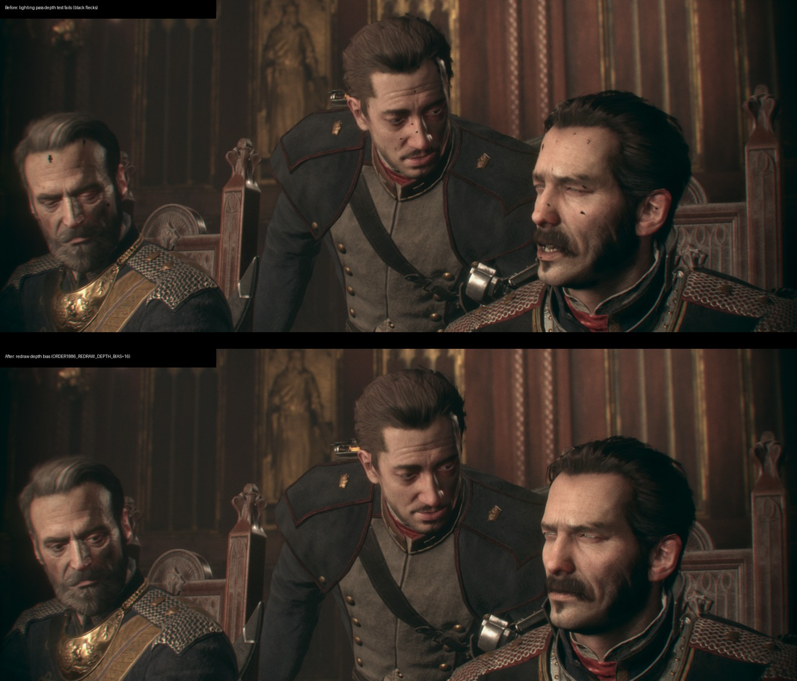

# Black flecks on faces: lighting pass failed its depth test

Reported in gameplay: black dots on characters' faces. Reproduced every time in the chapter II
"Evidence" cutscene (Council of Knights close-ups), and present in preview 9 as well.

## Cause

A RenderDoc capture of a dotted frame (RTX 3070, driver 617.14) shows how the faces are drawn:

1. The G-buffer pass draws the face mesh with one vertex shader and writes depth (LESS).
2. The lighting pass draws the same mesh again with another vertex shader, tests LESS_OR_EQUAL
   against that depth and writes none.

At a dotted pixel both passes rasterize the same primitive from the same post-VS positions, but the
fragment depth differs by a few ulps (sample 0: 0.87474018 written, 0.87474036 in the lighting
pass). The lighting fragment fails the test, the pixel is never shaded and stays at the target's
clear value: black.

The two GCN vertex shaders reach the position by different instructions (one indexes the bones
through registers, the other reads half-float data). The PS4 produces the same depth either way;
the Vulkan driver's compiles of the recompiled shaders do not.

## Fix

`Rasterizer::UpdateDepthStencilState` gives draws that redraw against an earlier depth pass (depth
test on, writes off, LESS_OR_EQUAL or GREATER_OR_EQUAL, no game polygon offset) a constant depth
bias of 16 units toward the camera. These draws write no depth, so the depth buffer is unchanged.
`ORDER1886_REDRAW_DEPTH_BIAS` sets the units; `0` turns it off.

Credit: TOport `6bbcc57` (14 October 2026, `BB_REDRAW_DEPTH_BIAS`) shipped this fix first, with the
same rule, the same names (`redraw_bias`, `redraw`) and the same sign choice
([IgorAugustoHH/The-Order-1886-PC-Port](https://github.com/IgorAugustoHH/The-Order-1886-PC-Port),
GPL-2.0).

## Evidence

Clean build from `main` (79cb4d0) plus this change, chapter II "Evidence" cutscene, 12 window shots
5 s apart per run:

| Run | Faces |
| --- | --- |
| `ORDER1886_REDRAW_DEPTH_BIAS=0` | Black flecks on Galahad, Percival and the Lord Chancellor |
| Default (16) | Clean in every close-up |

`bash build.sh --test`: 56 native checks pass.

## Not covered

- Marking `gl_Position` `Invariant` does not help: the two shaders compute the position by
  different instructions, and the attempt made more pixels fail.
- Other games that redraw with EQUAL are not covered; the bias needs a direction, so EQUAL is left
  unchanged.
