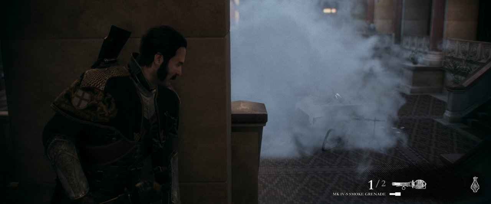

# Smoke grenade cloud

Reported in chapter I (Grande Lounge): the MK IV-S smoke grenade went off with no cloud. The
grenade, its sound and the enemies' reaction were there; the big smoke puffs were not drawn.

## Cause

The puffs are tessellated particles: LS `d1017d4b`/`de898f5f`, HS `85810f7d`, DS `539eee77` and
`3f7b85a9`. Three translation gaps hid them; each one alone is enough to lose the cloud.

- **Passthrough hull shader.** HS `85810f7d` only writes tess factors. Its layout is passthrough
  (`hs_output_base` 0, LS stride equal to the HS control-point stride), but it runs one thread per
  input control point (3 for 3). `IsPassthrough()` required exactly one thread, so the control
  points were never forwarded and the domain shader read zeros: every puff collapsed to a point.
- **Instance ID.** The hardware instance-ID VGPRs start at 0, and a draw's start instance only
  reaches the shader through the SGPR its packet names. Vulkan `InstanceIndex` includes
  `firstInstance` (18 in the game's indirect arguments), so without that SGPR the step-rate fetches
  and v3 indexed past the particle records. The prologue now subtracts `BaseInstance` when no base
  instance SGPR is set.
- **MUBUF ADDR64 loads.** The particle shaders read their records with `buffer_load_dword ... addr64`:
  the 64-bit pointer is in `v[vaddr:vaddr+1]` and the V# base is 0. Binding that V# gave a null
  buffer. These loads are now `ReadConst` pointer reads tagged `ReadConstAddr64Flag`; the SRT
  passes split the pointer into its uniform base plus lane offset and `LowerDynamicReadConstPass`
  binds the base as a bounded `ReadConst` buffer (4 MiB when the offset has no bound). Direct
  memory access stays off. A base that is not uniform constant memory reads zero with an error in
  the log instead of an assertion.

## Evidence

RTX 3070, chapter I from the save's Continue, a fresh copy of the save on every run, direct memory
access off (the player default) unless noted. F12 screenshots in
`out/order1886-evidence/chapter/<run>/gpu/screenshots/`.

| Run | Build | Smoke cloud |
| --- | --- | --- |
| main `4c9c20f` | before | none |
| smokepr3-004001 | this change | grey cloud in the screenshots, but reported broken while playing (likely the aim-focus bug below) |
| smokedma-090453 | this change, `ORDER1886_DIRECT_MEMORY_ACCESS=1` | grey cloud, matches PS4 (user) |
| smokeoff3-135617 | this change | rainbow cloud, haze tinted |
| smokecap-145550 (RenderDoc) | this change | stretched level geometry across the screen |
| smokenowatch-150049 | this change, `ORDER1886_READBACK_SHADERS=0` | grey cloud on both throws |

The two broken runs are the aim-focus readback bug that main still has
(`2026-10-23-aim-watch-explosion.md`): throwing aims, and the watched read's mid-frame `Finish()`
loses CPU-written vertices. In the RenderDoc capture (frame 3364) the stretched planes are draw
12089, ordinary level geometry (2,208 indices, no tessellation), whose vertex positions are 1e35
and NaN. With the watch off the same build drew the cloud correctly on every throw.

The compiled SPIR-V of every shader both runs met is identical between the DMA-on run and a
DMA-off run, so direct memory access does not change these shaders.

`bash build.sh --test` passes (57 native checks, including the new `addr64-readconst` check:
an unbounded ADDR64 offset binds the 4 MiB window from the pointer in user data, a bounded one
sizes the buffer from its index bound, and a lane-varying base reads zero without DMA or an
assertion).

## Not covered

- Smoke with the aim watch on and its fix applied together; that fix is a separate pull request.
- Other particle effects that use ADDR64 loads were not checked one by one; the SRT walker errors
  in the log (`ReadLane`, table-element, unflattened-read) were there before this change.
- Density and brightness against PS4 footage were judged by eye only.
