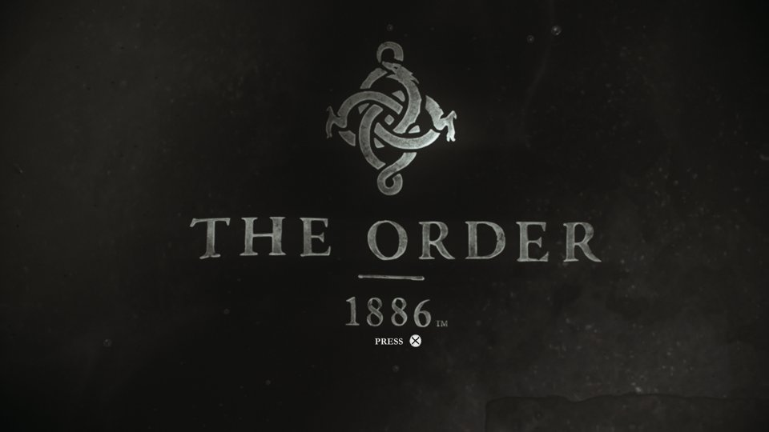

# Every 1.02 edition: 60 FPS and 16:9 bound to instruction bytes (#113)

Branch `fix/order1886-all-editions-1.02` (base `v0.2.2`, `1d6b3f9`). Runtime SHA256
`07e7021b482b7240d8210130845b318ac049e07fc5e0020844e74e2cc9982505`, RTX 3070 (driver 617.14),
Windows 11. Captured on 28 October 2026.

## The report

A player on v0.2.2 got, for any frame rate other than 30 or for 16:9:

> Selected settings do not match this executable. Detected APP_VER 01.02, VERSION 01.00.
> Experimental 60 FPS metadata mismatch for APP_VER: expected 01.00, found 01.02.

`verify_source_identity` checked the SELF SHA256, then the decoded ELF SHA256, then the
`param.sfo` triple. The message names the triple, so both hashes had passed: the player's
executable was byte-identical to the verified one. Only the SFO of update 1.02 refused it.

## Why the pinned executable is the 1.02 one

| Folder | TITLE_ID | APP_VER | VERSION | `eboot.bin` SELF SHA256 |
| --- | --- | --- | --- | --- |
| local base dump `CUSA00076` | CUSA00076 | 01.00 | 01.03 | `a8ce5fe1…` |
| update `CUSA00076-patch` (changeinfo "Photo mode", app_ver 01.02) | CUSA00076 | 01.02 | 01.00 | `a8ce5fe1…` |

Every file of the update apart from `sce_sys` and the disc maps is already in the base dump,
byte-identical, copied in on 15 October before the hash was pinned on 16 October. The recipe
itself is illusion's published **01.02** patch, whose XML lists CUSA00035, CUSA00070, CUSA00076,
CUSA00100, CUSA00670 and CUSA00785 at the same addresses (`0x008507c4` = RVA `0x4507be` + 6 +
image base `0x400000`; `0x0084ce8c` = RVA `0x44ce86` + 6 + base). The update SFOs of all six
editions (`Patch/CUSA000xx-patch`) are 01.02 / 01.00 and keep their saves under
`INSTALL_DIR_SAVEDATA` CUSA00035.

## What changed

Each recipe (60, 90, unlocked, 16:9, post effects, the catalogue) now requires one of those six
TITLE_IDs and the original instruction bytes at every site. The bytes are read from the decoded
ELF through its load segment (file offset `0x4000` maps RVA 0) before preparation, and again in
the prepared copy before any byte is written. No hash, APP_VER/VERSION or exact image size is
required. A build whose code differs at a site is refused with the RVA, the bytes found and its
APP_VER.

## Real run: base dump with the 1.02 update laid over it

`scripts/game_update.py` made a link view of `CUSA00076` with `CUSA00076-patch` over it, so the
game saw the reporter's SFO (APP_VER 01.02, VERSION 01.00) without either dump being modified.
`tools/order1886_graphics_probe.py --frame-rate 60 --aspect-ratio 16:9 --timeout 150`, fresh
state and cold shader cache:

| Check | Result |
| --- | --- |
| Preparation | accepted; `source_verified` true, edition CUSA00076 |
| 60 FPS edit (file offset `0x66e84c`) | `c7058c05170102000000` → `c7058c05170101000000` |
| 16:9 edit (file offset `0x66af14`) | `c78518fcffff9a991940` → `c78518fcffff398ee33f` |
| Guest flip rate over 146.7 s | 59.3 FPS (render work 59.2), p99 30.4 ms, worst 349.8 ms (cold shader compiles) |
| End | stopped by the probe's 150 s timeout, no `STOP:` line |
| Base dump afterwards | `param.sfo` still 01.00 / 01.03, `eboot.bin` unchanged |

The capture is the game's own output image at 140 s, not a desktop screenshot.

## Not established

- Gameplay at 60 FPS: the Chapter 6 and 9 QTE warning of the published patch still stands, and
  the 30-minute acceptance in `docs/order1886-4k60-verification.md` remains open.
- The five editions other than CUSA00076: only their update SFOs were available here, no
  executable. They are accepted as experimental and refused if their bytes differ.
- The 1.02 crash reports of #23 were not reproduced in this run.
