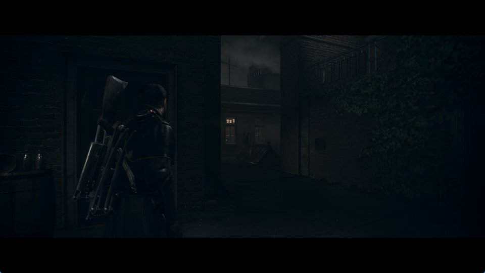

# v0.2.3 release verification

Release [v0.2.3](https://github.com/JulioCacko/The-Order-1886_pc/releases/tag/v0.2.3), built from
`e019b0f` on `release/v0.2.3` (`main` at `428ccff` plus the version and notes). Published
28 October 2026.

## Artifacts

| File | Bytes | SHA-256 | Built |
| --- | ---: | --- | --- |
| `order1886-go-windows.zip` | 112,447,547 | `b8cb9608c6390ec374168fe32b66500f924b0054aa723694695aa339985cc818` | Locally on Windows 11, MSYS2 clang64, from an LF clone (`core.autocrlf=false`) |
| `order1886-linux-x86_64.tar.gz` | 127,049,833 | `c2ad063c741d7c179fd2aa03e7bc651687e830df44b401cd8643245c9f4b8ef3` | [Workflow run 40629623066](https://github.com/JulioCacko/The-Order-1886_pc/actions/runs/40629623066) |

Runtime SHA-256: Windows `9cb312cbc4da4d53aa305245e5c5a547e362053d105a6a7948b2422d65cf9ad3`, Linux
`a9041a6a33e3fbae897c9f69bfa94e55a88650585146af99d4fa268811291ee6`. Both `runtime-build.json` files
name `e019b0f` with `source_dirty: false`. `release-verification.json` was written by
`packaging/order1886_release_receipt.py`.

## Checks

| Check | Result |
| --- | --- |
| `bash build.sh --test` in the release clone | 57 native checks pass |
| `python -m unittest discover -s tests` on the release branch | 555 run, 20 skipped, 0 failures |
| Windows portable smoke (`order1886-go-build.ps1`) | Pass |
| Updater `StageArchive` on the local zip | 234 files staged, `order1886-update-2` |
| Live updater test against the published release | `TestPublishedPreviewStages` stages v0.2.3: 234 files, source `e019b0f` |
| Linux portable smoke | Pass in run 40629623066 |
| Linux package on Ubuntu 26.04.1 (WSL, glibc 2.43) | `ldd` finds every library of the runtime, both launchers and the worker |

## Gameplay proof, Windows

RTX 3070 (driver 617.14), Windows 11. The packaged runtime from this release ran on the base
CUSA00076 dump with the 1.02 update laid over it through links: APP_VER 01.02, VERSION 01.00, the
case #113 reported. Settings: 60 FPS mode, VSync on, a cold shader cache and a copied save
(`tools/order1886_step1_evidence.py --runtime <package>/bin/order1886-runtime.exe --continue-save 30
--savedata <copy> --measure-after 95`).

| Scene | FPS | p50 ms | p99 ms | Frames over 33.3 ms |
| --- | ---: | ---: | ---: | ---: |
| Night courtyard, 95–139 s | 46.64 | 21.59 | 25.56 | 0 of 2,032 |

The 60 FPS patch applied (`c7058c05170102000000` → `…01000000`) and the save loaded.

The screenshot is the game window's client area only.

Preview 9 recorded 53.19 FPS in this scene. This release changes no rendering code: its runtime
changes are the edition check in `probe.c` and the per-edition trophy store. The two runs were not
done under the same conditions, and this verification did not look for the cause of the gap.

## Not covered

- Linux gameplay: WSL has only software Vulkan here. The package was checked with `ldd`, not
  run.
- The five editions other than CUSA00076: no executable of those editions was available.
- Gameplay timing above 30 FPS, including the Chapter 6/9 QTEs. Long sessions.
