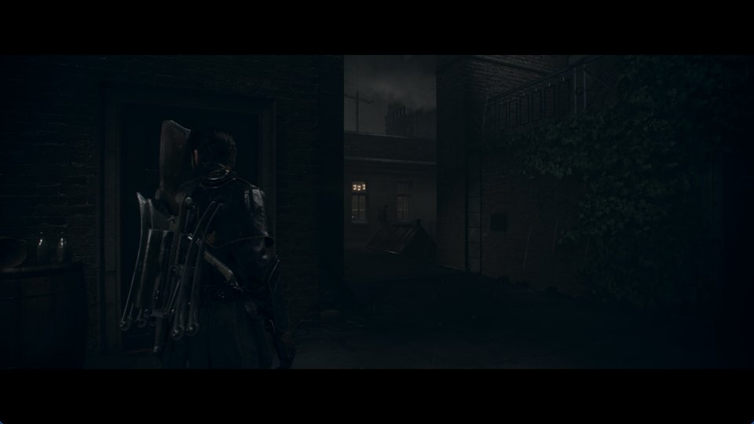

# v0.2.4 release verification

Release [v0.2.4](https://github.com/JulioCacko/The-Order-1886_pc/releases/tag/v0.2.4), built from
`a3c035c` on `release/v0.2.4` (`main` at `c038f27` plus the version and notes). Published
28 October 2026.

## Artifacts

| File | Bytes | SHA-256 | Built |
| --- | ---: | --- | --- |
| `order1886-go-windows.zip` | 112,453,317 | `8c22ef7f644a4b3f52c0d5bf7270799945447b9f8a64ef7d1543a75da12701e1` | Locally on Windows 11, MSYS2 clang64, from an LF clone (`core.autocrlf=false`) |
| `order1886-linux-x86_64.tar.gz` | 125,892,840 | `ed2bf93594217a807d486e5089267ecc4250774777bc9638e1900f3c1348b911` | [Workflow run 40672600009](https://github.com/JulioCacko/The-Order-1886_pc/actions/runs/40672600009) |

Runtime SHA-256: Windows `6badb775c2704445021d492b8fea0af3227b7d96b07caaf6d63e76740dd2e83f`, Linux
`a9041a6a33e3fbae897c9f69bfa94e55a88650585146af99d4fa268811291ee6` (the same Linux runtime as
v0.2.3: no runtime source changed). Both `runtime-build.json` files name `a3c035c` with
`source_dirty: false`. `release-verification.json` was written by
`packaging/order1886_release_receipt.py`.

## Checks

| Check | Result |
| --- | --- |
| `bash build.sh --test` in the release clone | 57 native checks pass |
| `python -m unittest discover -s tests` in the release clone | 557 run, 20 skipped, 0 failures |
| Windows portable smoke (`order1886-go-build.ps1`) | Pass |
| Updater `StageArchive` on the local zip | 234 files staged, `order1886-update-2` |
| Live updater test against the published release | `TestPublishedPreviewStages` stages v0.2.4: 234 files, source `a3c035c` |
| Linux portable smoke | Pass in run 40672600009, including the new checks: both entry points link no WebKitGTK, and a launcher window that fails to load reports the missing library |
| Linux package on Ubuntu 26.04.1 (WSL, glibc 2.43) | `ldd` finds every library of the runtime, the launcher window and the worker. Both entry points are static ("not a dynamic executable") |

The #114 behaviour itself (entry points start and play on Arch Linux without WebKitGTK, and open the
launcher window where WebKitGTK exists) is recorded in
[2026-10-28-linux-without-webkitgtk.md](2026-10-28-linux-without-webkitgtk.md).

## Gameplay proof, Windows

RTX 3070, Windows 11. The packaged runtime from this release ran on the base CUSA00076 dump with the
1.02 update laid over it: 60 FPS mode, VSync on, a cold shader cache and a copied save
(`tools/order1886_step1_evidence.py --runtime <package>/bin/order1886-runtime.exe --continue-save 30
--savedata <copy> --measure-after 95`). The save loaded.

| Run | FPS | p50 ms | p99 ms | Frames over 33.3 ms |
| --- | ---: | ---: | ---: | ---: |
| v0.2.4 package | 37.53 | 26.58 | 28.90 | 0 of 1,596 |
| v0.2.3 package, same session | 37.31 | 26.44 | 29.67 | 3 of 1,526 |
| v0.2.4 package, repeated | 35.14 | 28.52 | 34.34 | 35 of 1,481 |

Night courtyard, 95–139 s.

The screenshot is the game window's client area only.

v0.2.3's own verification recorded 46.64 FPS in this scene. Its package measured 37.31 FPS in this
session, so the drop comes from conditions on this machine, not from this release. The cause was not
investigated.

## Not covered

- Linux gameplay: WSL has only software Vulkan here. The package was checked with `ldd`, not run.
- A real Steam Deck, Steam Game Mode and the zenity/notify-send dialog.
- The five editions other than CUSA00076. Gameplay timing above 30 FPS, including the Chapter 6/9
  QTEs. Long sessions.
