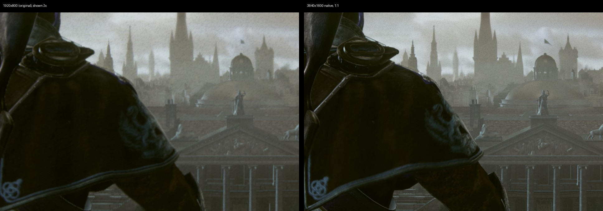
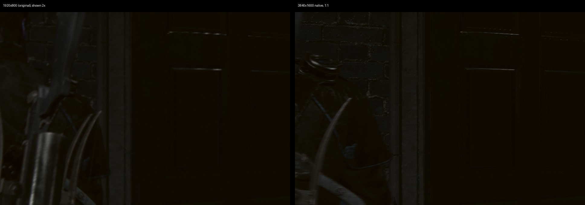

# Native render resolution: the game draws 3840x1600 (and 3840x2160) itself

Goal (#3, #2): the game renders at the size the player picks, up to native 4K, with no
upscaler in the path. Graphics → **Render resolution** now does that on 01.02.

## How the game was made to render larger

All four edits are in `scripts/order1886_resolution.py`. They apply to the prepared copy of the
executable only, and every site's original bytes are checked first.

1. **Display mode.** The engine's display-mode switch at RVA `0x44cef3` has fixed 1280x720,
   1920x1080 and 3840x2160 modes that retail never selects. The recipe always takes the 720p
   branch and writes the chosen size into its output and viewport stores. This is the same
   mechanism as the published 900p/720p patch, plus the viewport stores. With only this edit
   the G-buffer, lighting and post chain follow the new size, but scene depth stays 1920x800
   and gameplay frames stop after six passes.
2. **Base scene size.** The renderer is created with a fixed `(1920, 800)`
   (`mov edi, 0x780; mov esi, 0x320` at `0x839c54`), stored in the device at `+0x738/+0x73c`,
   and that size sizes scene depth. The recipe writes the scene size: width/2.4 for Original,
   the full frame for 16:9. The same mismatch is the likely cause of the 16:9 patch's own
   warning about native 1080p.
3. **Render-target memory.** With 1 and 2, the first gameplay frames rendered correct geometry
   and lighting at 3840x1600, then went to garbage after the temporal resolve. The pass images
   showed the motion-blur output as zeros and NaN, and every later pass carried that. The
   frame census showed live targets overlapping in guest memory: the 49 MiB TAA history ran
   into a G-buffer target, and the G-buffer ran into scene depth. Ghidra found the cause in
   `GpuStack.RenderTargets` (built at `0xca5dc0`). Its partitions are fixed for 1920x800:
   162 MiB for the main stack, then 19 MiB and 73 MiB shared by sub-stacks used at different
   times. A 4x frame overflows the first partition into the other two. The recipe scales each
   partition by the scene's pixel count (total size at `0xca6030`, partition starts and sizes
   in `0xca5dc0`).
4. **GPU heap.** The stack is carved from the 654 MiB GPU heap (`0x28E00000`, allocated at
   `0x298d0b`, mapped at `0x298d33`, recorded at `0x298d63`, released at `0x2997cc`). The heap
   grows by the stack's growth, and the launcher raises guest direct memory by the same
   amount (`ORDER1886_DMEM_MB`: 5818 MiB at 3840x1600, 6176 MiB at 3840x2160).

Growing the heap alone (step 4 without step 3) changed nothing: every target landed at the same
address. That is how the stack, not the heap, was identified as the limit.

The sites' immediates are signed 32-bit, so the width is capped at 4880 for Original and 4192
for 16:9. Above the original size, Upscaling is set aside: `presentation_filter=linear`, no
temporal provider, and the frame is presented 1:1 (`order1886.py`, `write_runtime_config`).

## Evidence

- **Setup:**
  - RTX 3070 on Windows 11, 01.02 (CUSA00076).
  - Runtime `64f0dcae` (source `8c481e1`). This change touches no C++, only the prepared image
    and the launcher.
  - Copy of a playthrough save, Linear presentation, 30 FPS cap.
- **Scenes:**
  - the save's night street (Continue);
  - Chapter II "Evidence" (Council cutscene);
  - Chapter I "Even Watchful" (rooftop, daylight).

**Render-target sizes.** The RenderDoc capture of Chapter I at 3840 shows:
- the G-buffer (R10G10B10A2 ×4, R16_UINT), depth, lighting and scene colour (RGBA16F) and the
  tonemap target (RGBA8 sRGB), all at 3840x1600;
- DOF, bloom and luminance at 1920x800;
- motion-blur tiles down to 120x50, and the light-tile grid at 240x100;
- the presented buffer at 3840x2160 RGBA8.

The only smaller full-frame image is the 1920x1080 window swapchain. No upscale pass runs. In the frame
census of the save street, 17 screen-sized targets are 3840x1600, 13 are 1920x800, and no two
targets that are live at the same time overlap. The one adjacent pair has the same spacing and
the same disjoint lifetimes as at native size.

**Image.** The frame dumps are 3840x2160. The crops above and below put the 1920 run's frame
enlarged 2x next to the 3840 run's frame at 1:1, in the same scene. 16:9 at 3840x2160 renders full
screen and clean in the same save.

**Frame time** (runtime frame stats, no RenderDoc layer; RenderDoc alone costs 50 to 70% at 4K):

| Scene | 1920 (original) | 3840x1600 native |
| --- | --- | --- |
| Night street (save) | 30.0 FPS, p99 34.5 ms | 30.0 FPS, p99 34.6 ms |
| Chapter I rooftop | 30.0 FPS | 30.0 FPS, p99 34.6 ms, 0 slow frames |
| Chapter II Council cutscene | 30.0 FPS, p99 34.5 ms | 27.4 to 30 FPS, p99 67.4 ms, 13 frames over 1.5x median |

Gameplay holds the 30 FPS bar at 4K on this GPU. The Council cutscene, with close-up faces,
depth of field and heavy MSAA lighting, drops single frames to 67 ms at 4K.

## Not covered

- **60 FPS patch:** not measured at 4K.
- **Shadow-map resolution:** not changed; this is the next phase, after #122.
- **MSAA:** stays as it is: guest-preserving, 2x on the host.
- **Builds:** 1.02 only. The recipe refuses an executable whose bytes differ.
- **Widths above 4880 / 4192:** would need a code cave.
