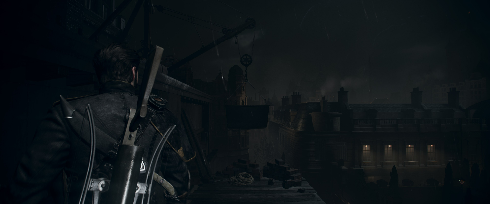

# v0.2.5 release verification

Release [v0.2.5](https://github.com/JulioCacko/The-Order-1886_pc/releases/tag/v0.2.5), built from
`69b9f58` on `release/v0.2.5` (`main` at `bbff6d8` plus the version and notes). Published
29 October 2026.

## Artifacts

| File | Bytes | SHA-256 | Built |
| --- | ---: | --- | --- |
| `order1886-go-windows.zip` | 112,462,599 | `c19e2e303279e2eaa4a83d346d4f737a488e76c1186ad64155a09c78cfc7dd2c` | Locally on Windows 11, MSYS2 clang64, from an LF clone (`core.autocrlf=false`) |
| `order1886-linux-x86_64.tar.gz` | 125,916,758 | `9cd1d254c8ca6602fe0e3c4b7deeafaa83c99126d2f37c8374ce1f482152a4ec` | [Workflow run 40978220705](https://github.com/JulioCacko/The-Order-1886_pc/actions/runs/40978220705) |

Runtime SHA-256: Windows `daf548022e8dcc8e067ed6bfaad8048a00439a87e06d8d6087662ad5dfe1b550`, Linux
`cc0db385631f863229550a234ba6e69805219db8942d9bc7b149152a7663367c`. Both `runtime-build.json` files
name `69b9f58` with `source_dirty: false`. `release-verification.json` was written by
`packaging/order1886_release_receipt.py`.

## Checks

| Check | Result |
| --- | --- |
| `bash build.sh --test` in the release clone | 57 native checks pass |
| `python -m unittest discover -s tests` in the release clone | 565 run, 20 skipped, 0 failures |
| Windows portable smoke (`order1886-go-build.ps1`) | Pass |
| Updater `StageArchive` on the local zip | 235 files staged, `order1886-update-2`, source `69b9f58` |
| Linux portable smoke | Pass in run 40978220705 |
| Linux package on Ubuntu 26.04.1 (WSL) | `ldd` finds every library of the runtime, the launcher window and the worker. Both entry points are static |

## Gameplay proof, Windows

RTX 3070, Windows 11. The packaged runtime from this release ran on the base CUSA00076 dump with the
1.02 update laid over it: Render resolution 3840 (scene 3840×1600, guest memory raised to 5,818 MB
by the recipe), 30 FPS mode, Linear presentation, borderless on a 3840×2160 display, and a copied
save (`tools/order1886_graphics_probe.py --runtime <package>/bin/order1886-runtime.exe
--render-width 3840 --display-mode borderless`, driven by `tools/order1886_scene_driver.py`). The
save loaded on a night rooftop.

After the save loaded, the runtime's frame statistics reported 30.0 FPS in every 5-second window
(25 windows). The worst frame per window was 34.9 ms, apart from one window at 132 ms and three at
66 ms.

The screenshot is the game window's client area at 3840×2160, cropped to the 3840×1600 scene.

The other native-resolution measurements (Chapter I rooftop, Chapter II Council cutscene) and the
RenderDoc structure checks are in [2026-10-29-native-resolution.md](2026-10-29-native-resolution.md).
They used a development runtime from the same source as `main` at `bbff6d8`.

## Fix made during the release

The first Windows build reported `source_dirty: true`. The submodules had been checked out by Git for
Windows with CRLF line endings, so the MSYS2 git that `build.sh` calls saw them as modified. Setting
`core.autocrlf=false` in each submodule and checking them out again made the tree clean, and the
runtime and package were rebuilt from that tree. Clone with `--recurse-submodules` and
`-c core.autocrlf=false` to avoid this.

## Not covered

- Original-resolution (1920×800) gameplay with this package: the release has no runtime change at
  that size apart from #125 and #124, and the run was not repeated.
- Linux gameplay: WSL has only software Vulkan here. The package was checked with `ldd`, not run.
- 3840×2160 with 16:9 framing from the package, Chapter scenes from the package, base 1.00, the five
  editions other than CUSA00076, the Chapter 6/9 QTEs and long sessions.
- New launcher screenshots: the README keeps the preview 9 launcher shots.
