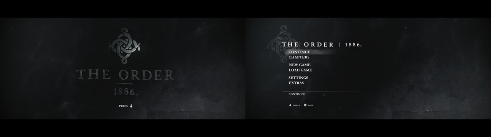
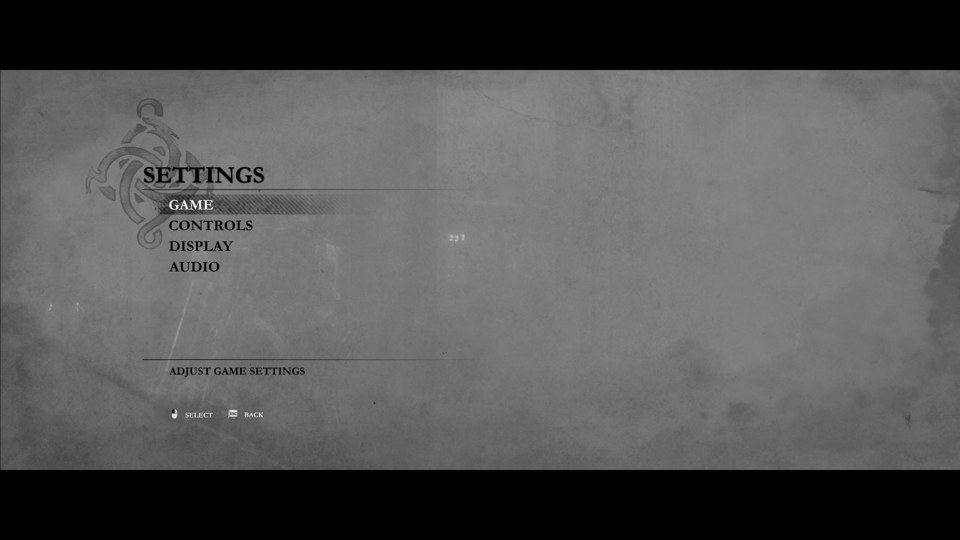

# Menu mouse and Esc input (2026-10-31)

Left click selects and Esc goes back in The Order's menus; in gameplay left click still fires
and Esc pauses. Runtime built from `feat/menu-pointer-routing` (on PR #135), 1.02 executable
(CUSA00076), from a copy of a playthrough save. The player's own state was not used.

## How a menu is recognised

Found with Ghidra on the 1.02 eboot and checked in the live process by reading guest memory:

- The Game singleton at image offset `0x16ab8b0` holds a list of UI objects (`+0x348`, count
  `+0x370`). The UI object (vtable `0x1640420`, type `UI`) is built in `fde_4442e0`.
- `UI+0x48` is the root page. Every page keeps its children at `+0xa0` (count `+0xc8`);
  `fde_af83d0` pushes a child at the end, so the last child is the page in front.
- Each object has its type hash at `+0x28`, the same 8 bytes that come before its type name in
  the executable (`0xcacf46d896d1adfd` = `GamePlayerPage`).

Front leaf in each state, read from the running game:

| Screen | Page tree under the root (last child first) | Front leaf |
|---|---|---|
| Main menu | RootPage > BeginPage | `BeginPage` |
| Gameplay | RootPage > GamePage > GamePlayerPage | `GamePlayerPage` |
| Pause | ... GamePage > PausePage | `PausePage` |
| Pause > Settings | ... PausePage > SettingsPage | `SettingsPage` |
| Pause > Settings > Controls | ... SettingsPage > ControlsPage | `ControlsPage` |
| Back out with Circle, three times | ... | `SettingsPage`, `PausePage`, `GamePlayerPage` |

Static `.data` flags were tried first (memory diffs between menu and gameplay dumps), but no
single byte held for the title, main menu and pause menu together. The page tree did.

## Live runs

- Runtime log on every run: `Runtime: menu input: left click selects and Esc goes back while a
  menu is open`, then `menu input on` and `off` on each change between a menu and gameplay.
- Pad recording (`ORDER1886_PAD_RECORD`) during a run with the keyboard layout: Esc reached the
  game as Options (`8`) in gameplay and as Circle (`8192`) in the pause menu, in turn. That is
  pause, then back to the game, then pause again.
- The owner played the run with mouse and keyboard and reported that the mouse did not work.
  The recording showed why: mouse look stopped after the first Esc, and R2 never reached the
  game. Esc was still releasing the cursor. After the fix (Esc no longer releases the cursor
  when menu input is attached), the owner played again and confirmed that it works.
- Keyboard button prompts rebuilt with the new menu entries (151 bitmaps). Frame dumps
  (`ORDER1886_FRAME_DUMP_TRIGGER`, the game's own frame, no desktop):

## Checks

- `bash build.sh --test`: 57 native checks pass. `pad-test` covers a gameplay click giving R2,
  a menu click giving Cross with the cursor captured or released, a held click keeping its
  meaning when the menu closes, the main menu leaf, the version check, and Esc routing.
  `mouse-look-test` covers a click with the cursor released.
- `python -m unittest discover -s tests`: 586 tests pass (20 skipped). The prompts tests check
  that the MenuApp Cross and Circle use the left-mouse drawing and the ESC keycap.
