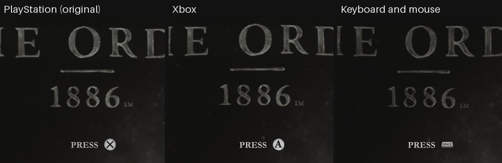
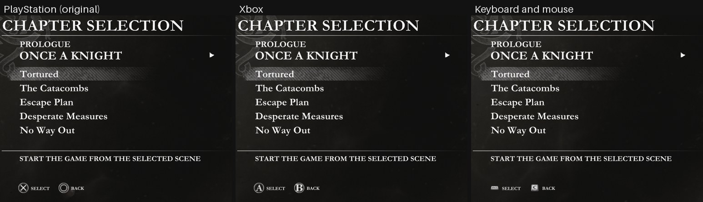
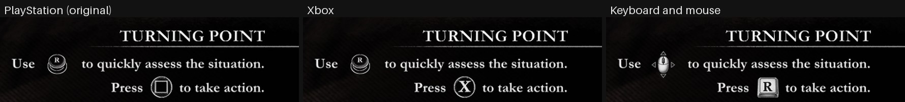

# Button prompt coverage: every PlayStation marking (2026-11-01)

Question: with Xbox or Keyboard and mouse prompts, which bitmaps still show a PlayStation
marking, and why? The plan from #135 changed 98 bitmaps for Xbox and 151 for the keyboard,
and in gameplay the weapon HUD still read R1.

## Inventory

All 1090 bitmaps of the 17 UI movies (`order1886_ui_extract.KNOWN_UI`, CUSA00076 1.02) were
decoded from the player's dump and reviewed on contact sheets (kept outside the repository).

- 290 bitmaps have a button-class owner (`ButtonIcon*`, `Button_<token>_*`). All 290 were in
  the plan; the build reached 260 of them, since the Xbox set keeps the 29 D-pad bitmaps and one
  entry had the unknown glyph `button`.
- 18 more bitmaps show a button but no button class owns them, so `glyph_bitmaps()` never
  reached them:

| Bitmap | Owner | Shows |
|---|---|---|
| WeaponApp-13d44-292, -295 | `AltFire`, `ItemEquipped` | "R1", "R2" weapon HUD labels |
| WeaponApp-13d44-9, -11 | `EvadeIndication` | cross |
| InteractApp-34c664-1027, -1029 | `WorldInteractButtonMash` | cross |
| InteractApp-34c664-1075, -1076, -1078 | `InteractButtonMash` | triangle |
| InteractApp-34c664-269 | `WorldInteract`, `WorldInteractHold` | triangle |
| StealthApp-3329c4-61, -62 | `StealthTakedown` | triangle |
| MenuApp-4-254, MenuApp-14af84-254 | `BeginDemoMenu` | cross |
| IndicatorApp-b5d4-19 | `HintLook` | right stick printed "R3" |
| IndicatorApp-b5d4-12 | `ControllerInfluence` | right stick "R" |
| CinemeleeApp-515fcb4-36, -89584b4-36 | `LycanEvadeButtonRS` | right stick "R" |

- 16 kept entries carry a marking: L1, L2, L3, R1, R2, R3, square (3), triangle (2) and
  circle (2) build-in frames in InteractApp and StealthApp, the 32 px menu cross
  (MenuApp-*-223), and InteractApp-34c664-287 (glyph `button`, really a triangle).
- InteractApp-34c664-78 and -53 are sticks printed "L3" and "R3".

## Changes

- `plan.json` names the 18 unowned bitmaps (308 entries) and turns the 16 kept entries into
  `face` or `label`. `xbox_glyph` gives the two "L3"/"R3" sticks and the look hint LS/RS on
  Xbox while the keyboard keeps WASD and the mouse.
- `glyph_bitmaps()` includes plan-listed bitmaps without a button-class owner.
- Light buttons: the old symbol's grey anti-aliased edges are now removed with it
  (`old_ink` below 200 on a white body). Before, a ghost triangle or square corners stayed
  around the new letter (InteractApp-34c664-272/274, StealthApp-3329c4-24/26, -1048, -1050).
  This also changes 9 bitmaps that the earlier plan already edited, all of which lose residue.
- The 26 px weapon HUD labels use their whole bitmap for the keycap or mouse.

Rebuilt from source with `order1886_prompts.prepare`: Xbox changes 131 bitmaps (was 98),
keyboard 185 (was 151). Decoding the built resources and diffing every bitmap against the
dump: every planned bitmap changed, no unplanned bitmap changed, every size is unchanged and
every movie fits its package slot.

## What stays PlayStation, and why

- D-pad (Xbox): both pads have the same D-pad.
- Sticks printed "L" or "R" (Xbox): both pads have the same sticks; Xbox-style "LS"/"RS"
  replaces only the "L3"/"R3" ones.
- Animation layers with no marking: rings, glows, blank discs, wipes, fail splats and timer
  arcs (every kept cross, circle, square, triangle, L and R entry was checked on a sheet).
  InteractApp-34c664-1330 is a hatch layer of the R1 build-in with faint residue; it stays.
- Pictures of the DualShock 4 itself: MenuApp 194 and 197 (Controls diagrams), MenuApp 33 and
  36 (pause-menu and touchpad option icons; 36 shows beside PHOTO MODE in the pause menu) and
  InteractApp-34c664-1463 (tutorial controller drawing). These need new controller
  illustrations from the project owner; no mark or keycap in `scripts/button_prompts/` fits.

No keyboard key is missing art: the layout's keys all have a mark or a drawing.

## In-game check

Runtime built from this branch (`out/order1886-runtime.exe`, SHA-256 `dec85cf6…`), launched
through the backend (`order1886.py --button-prompts playstation|xbox|keyboard`) with fresh
state folders holding a copy of the player's `savedata`, driven by
`tools/order1886_scene_driver.py`. Window client-area shots only.

| Scene | PlayStation | Xbox | Keyboard and mouse |
|---|---|---|---|
| Title | PRESS ⊗ | PRESS (A) | PRESS (Space keycap) |
| Main menu, chapter select | ⊗ SELECT ○ BACK | (A) SELECT (B) BACK | Space SELECT, C BACK |
| Prologue, Desperate Measures: Turning Point tutorial | R stick, □ | R stick, (X) | mouse, R |
| Prologue QTE | — | (X) | — |
| Pause menu | — | (A)/(B); DS4 icon beside PHOTO MODE | — |

Not verified in game: the weapon HUD R1/R2 labels. A Continue save and Chapter III
(Rebel Declamation) both started in exploration with weapons holstered, and the scene
driver could not navigate to a firefight. The labels are verified only offline: the built
WeaponApp bitmaps 292 and 295 read RB and RT (Xbox) and show the Y keycap and the left mouse
button (keyboard).
