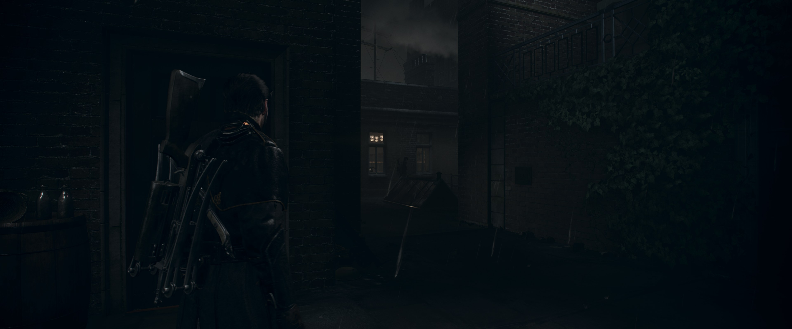
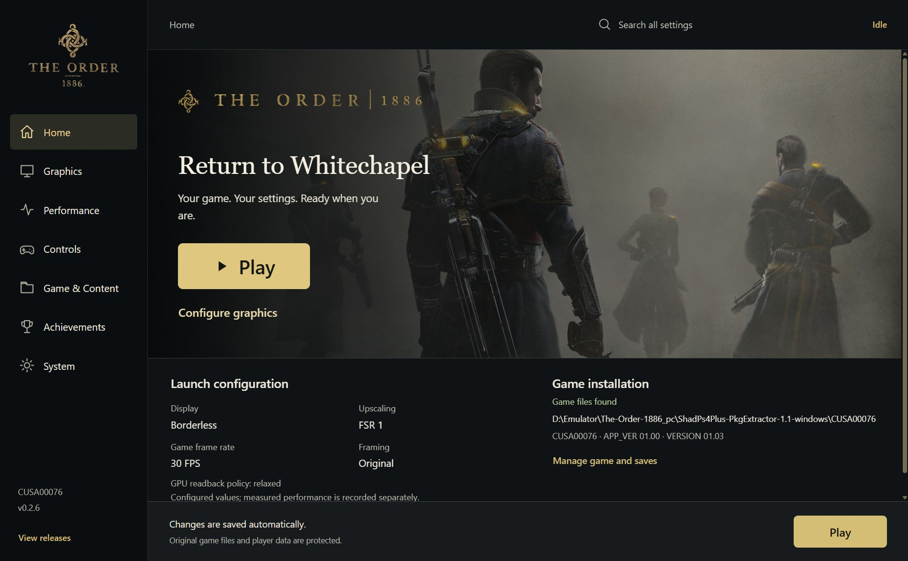

# v0.2.6 release verification

Release [v0.2.6](https://github.com/JulioCacko/The-Order-1886_pc/releases/tag/v0.2.6), built from
`f45149e` on `fix/v0.2.6` ([#137](https://github.com/JulioCacko/The-Order-1886_pc/pull/137):
`release/v0.2.5` plus the #131, #127, #133 and #134 fixes, the version and notes, and a Linux
build fix). Published 1 November 2026.

## Artifacts

| File | Bytes | SHA-256 | Built |
| --- | ---: | --- | --- |
| `order1886-go-windows.zip` | 113,103,745 | `6483695d52a537637649bad5afc87620994e7978973b78d5dd54998144e3f9fa` | Locally on Windows 11, MSYS2 clang64, from an LF clone (`core.autocrlf=false`) |
| `order1886-linux-x86_64.tar.gz` | 125,993,124 | `48b00d06efbe4195097cd089a257d5df316e1bde5d691f4855366dccecfa2547` | [Workflow run 41266810207](https://github.com/JulioCacko/The-Order-1886_pc/actions/runs/41266810207) |

Runtime SHA-256: Windows `f1b47dd4253199f8a51ff5fd69937d7772baff979aa6ee07e7cc9004a9996e0c`, Linux
`4d3622faf460e0ba2adae735285adf5a8e993bfc12573de930075fdd3f9ebe65`. Both `runtime-build.json` files
name `f45149e` with `source_dirty: false`. `release-verification.json` was written by
`packaging/order1886_release_receipt.py`.

## Checks

| Check | Result |
| --- | --- |
| `bash build.sh --test` in the release clone | 57 native checks pass |
| `python -m unittest discover -s tests` in the release clone | 568 run, 20 skipped, 0 failures (at `8d1b65f`; `f45149e` changes one Linux-only line) |
| `go test ./...` (launcher) and frontend `npm test` | 139 and 33 pass |
| Windows portable smoke (`order1886-go-build.ps1`) | Pass |
| Updater `StageArchive` on the local zip | 235 files staged, `order1886-update-2`, source `f45149e` |
| Live updater test against the published release | `TestPublishedPreviewStages` stages v0.2.6: 235 files, source `f45149e` |
| Linux portable smoke | Pass in run 41266810207 |
| Linux package on Ubuntu 26.04.1 (WSL) | `ldd` finds every library of the runtime, launcher, worker, `libps4gpu.so` and both entry points |

## Gameplay proof, Windows

RTX 3070, Windows 11, 3840×2160 display. The packaged runtime ran the CUSA00076 dump at
Render resolution 3840 (scene 3840×1600), 30 FPS mode, Linear presentation, borderless
(`tools/order1886_graphics_probe.py --render-width 3840 --display-mode borderless`, driven by
`tools/order1886_scene_driver.py` from a copied save). It reached gameplay and ran until the
probe's 330-second limit with no `STOP:` line.

The proof run used the `8d1b65f` package. `f45149e` differs only by a `(void)name;` on the Linux
side of `set_host_priority`, so the Windows code is the same.

### #133 (exit 23)

An earlier local run of the v0.2.5 runtime (`daf548…`, the reporter's build) on the same path
stopped after 148 s with exit 23 at `liverpool.cpp:751 ProcessGraphics: Unimplemented PM4 type 0`:
the command processor lost its place in a command buffer, with the draw pipe active. The ported
SpartanPort fixes `174250425e` (packet sizes read before the packet runs, for buffers the guest
reuses after a flip) and `2866adc5ac` (draw-pipe drain race) address that class. The crash is not
deterministic: a fresh v0.2.5 run on the same path also lasted the full 330 s. The fixes are
therefore not confirmed against #133.

## Launcher

The packaged launcher's window client area, captured with `PrintWindow`. It shows v0.2.6.

## Fixes made during the release

- The first Linux package run (41265203303) failed: `src/runtime_thread.c` left `name` unused on
  the Linux side of `set_host_priority` under `-Werror`. Fixed in `f45149e`.
- After `git pull` in the release clone, the global `core.autocrlf=true` rewrote the changed file
  with CRLF and the runtime reported `source_dirty: true`. Setting `core.autocrlf=false` in the
  clone (not only at clone time) and checking the file out again made it clean; the runtime and
  package were rebuilt.

## Not covered

- #134: total CPU use did not measurably drop under 6- and 4-thread affinity on the test CPU
  ([thread priority verification](2026-10-31-thread-priorities.md)).
- The System page's new controls (Up to date, Use installation runtime, folder buttons) were not
  photographed; they are covered by Go, frontend and Python tests.
- Linux gameplay, original-resolution gameplay from this package, the five other editions, the
  Chapter 6/9 QTEs and long sessions.
