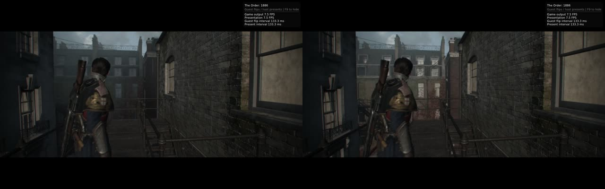
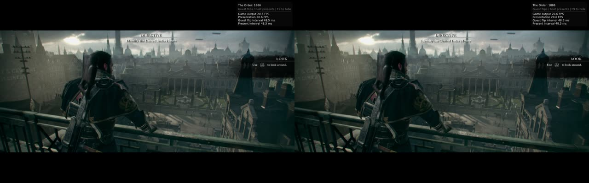

# Sun-shadow flashes: CPU writes to the depth-range pages are not deferred (#142)

Run on a Steam Deck LCD (SteamOS, RADV), readbacks **Relaxed**, Chapter I "A Lady in Waiting" / 1-1.
The fix is a port of the IgorAugustoHH/The-Order-1886-PC-Port commit
[c0195df](https://github.com/IgorAugustoHH/The-Order-1886-PC-Port/commit/c0195dfb336cea7d9bdc9722aac41a3f6e940183)
("Lighting fixes", GPL-2.0), reduced to its synchronous form.

## Symptom

Shadowed surfaces turn fully lit for single frames, mostly outdoors and in cutscenes, sometimes for
30–45 s at a time (#142).

## Cause

- In the bad frames the lighting pass reads its sun-cascade constants as 12 × `0xffc00000`, the x86
  default NaN, followed by default split distances of 0.1 or 0.11. With a NaN transform the EVSM
  lookup finds no occluder, so every shadowed pixel is lit.
- Those constants come from the GPU's depth-range result (compute shaders `0x7550d841`,
  `0x7b1b18c9` and the atomic float min/max reductions), which the CPU uses to fit the cascades.
- Next to the NaN runs in guest memory sit +∞/−∞ pairs, which are the reset value of an empty
  min/max. The CPU resets the result before the GPU writes it again. ∞ − ∞ gives the NaN.
- The CPU's first access to those pages is that **write**, not a read. The deferred readback
  (TOport 32efe96) lets a write beside GPU-written bytes go ahead without fetching those bytes first.
  So the game computes from its own reset values instead of the GPU's result.
- This is why the readback log never showed these pages: it records CPU reads. The address the fix
  acts on in this run, `0x106ea85520`, is the one #142 listed as "never written by the GPU". It shares
  a page with the output of `0x7b1b18c9`, and the shared page is exactly what triggers the bug.

## Fix

- Buffers *written* by those shaders are registered in `BindBuffers`.
- In `BufferCache::ReadMemory`, a CPU write to one of their pages skips `DeferReadback` and takes
  the synchronous path.
- `ORDER1886_SUN_SYNC=0` turns it off.

TOport's full version also avoids the wait: it keeps copies of these ranges and hands the CPU the
newest finished one. That part is not included here (see **Open**).

## Evidence

The log of the fixed run shows the registration and the writes it no longer defers:

```
Readback sync: 0x105918b64c size 12288 (shader 000000007550d841)
Readback sync: 0x106ea85360 size 192 (shader 000000007b1b18c9)
Readback sync: CPU write at 0x106ea85520, not deferred
Readback sync: 0x106ea85440 size 192 (shader 000000007b1b18c9)
Readback sync: CPU write at 0x106ea855a0, not deferred
```

**Before** (diagnostic build, same chapter): the background buildings switch between lit and unlit
on alternate frames.



**After** (5.5-minute recording from the start of 1-1 through the house interior and back
outside): no flashes. Two frames half a second apart on the rooftop:



The game still skips the cascade *update* on some frames: the per-frame count of draws into the
1024² cascade maps still switches. In those frames it now uses valid constants. The skipping is the
game's own scheduling; the NaN was the bug.

## Open

- **Same-scene pair with the switch on and off** (`ORDER1886_SUN_SYNC=0`) on a build with no
  diagnostics: pending.
- **Frame rate outdoors:**
  - The recorded run, a build that still had diagnostics, gave 19–24 FPS on the rooftops and 15–22
    FPS in the alley, but a steady 30 FPS indoors.
  - The stall breakdown showed 0 ms of readback waits, but the synchronous download may still cost
    CPU/GPU overlap.
  - The same-scene comparison above decides whether TOport's copy-delivery part is needed.
- **Unrelated, seen in the same recording:**
  - In the small prompt-title font, capital L and D draw as "h" ("hOOK", "h IRECTIVE").
  - The same fault appeared intermittently in earlier runs without this change, possibly in
    low-FPS stretches, so it is tracked separately.
